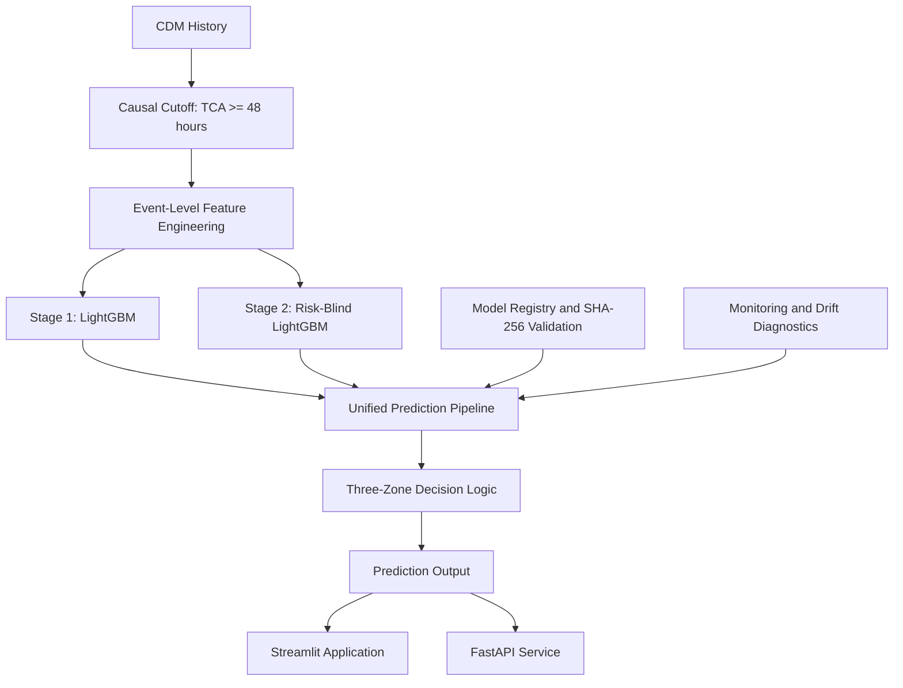

# ORBITAL-AI
## Physics-Guided Spacecraft Collision-Risk Assessment & Astrodynamics Workbench

[](https://www.python.org/)
[](https://lightgbm.readthedocs.io/)
[](https://fastapi.tiangolo.com/)
[](https://streamlit.io/)
[](#scope-and-limitations)

**ORBITAL-AI** is an end-to-end research prototype for spacecraft conjunction-risk assessment. It combines event-level machine learning, causal CDM-history processing, physics-informed feature engineering, model governance, and an interactive orbital-mechanics workbench.

The project is based on the **[ESA Kelvins Spacecraft Collision Avoidance Challenge](https://kelvins.esa.int/collision-avoidance-challenge/)** dataset and the post-competition analysis by **[Uriot et al. (2022)](https://www.sciopen.com/article/10.1007/s42064-021-0101-5)**.

<p align="center">
  <a href="https://orbital-esa-collision-avoidance-3ewp7cecpuqb3kh6kmmbse.streamlit.app/"><strong>Launch the ORBITAL-AI application</strong></a>
</p>

> **Important:** ORBITAL-AI is a research and engineering prototype. It is not flight-certified, is not an operational collision-avoidance service, and must not be used as the sole basis for spacecraft maneuver decisions.

---

## Table of contents

- [Project overview](#project-overview)
- [What the system includes](#what-the-system-includes)
- [System architecture](#system-architecture)
- [Machine-learning methodology](#machine-learning-methodology)
- [Research results](#research-results)
- [Orbital mechanics workbench](#orbital-mechanics-workbench)
- [Quick start](#quick-start)
- [API overview](#api-overview)
- [Repository structure](#repository-structure)
- [Data and reproducibility](#data-and-reproducibility)
- [Scope and limitations](#scope-and-limitations)
- [References](#references)

## Project overview

A conjunction event is represented by a sequence of **Conjunction Data Messages (CDMs)** describing how the estimated state and collision-risk information evolve as two space objects approach a possible encounter.

ORBITAL-AI processes the available CDM history at the **event level**, rather than treating every CDM as an independent prediction sample. Its main ML workflow uses information available at least **48 hours before the Time of Closest Approach (TCA)**:

```
CDM history
    |
    v
48-hour causal cutoff
    |
    v
Event-level feature engineering
    |
    v
Two-stage LightGBM inference
    |
    v
Risk assessment and prediction output
```

The project also provides a separate astrodynamics workbench for exploring relative motion, covariance geometry, encounter-plane probability calculations, and collision-avoidance maneuver scenarios.

## What the system includes

| Component | Description |
|---|---|
| **Causal CDM processing** | Filters observations to preserve the 48-hour pre-TCA decision boundary. |
| **Event-level feature engineering** | Converts variable-length CDM histories into structured features describing relative motion, covariance evolution, tracking quality, and encounter geometry. |
| **Two-stage ML model** | Uses a Stage-1 LightGBM model and a Stage-2 model governed by an explicit physical-feature allowlist. |
| **Risk-blind Stage 2** | Excludes operational risk-history features from the Stage-2 physical feature set. |
| **Unified inference engine** | Shares the inference path between the Streamlit application and FastAPI service. |
| **Model registry** | Tracks model artifacts and verifies their SHA-256 integrity before loading. |
| **Monitoring** | Provides inference telemetry and feature-drift diagnostics. |
| **Astrodynamics workbench** | Explores relative orbital motion, covariance projection, encounter geometry, and CAM scenarios. |
| **Research archive** | Preserves notebooks, experiment outputs, evaluation protocols, and a companion book manuscript. |

## System architecture

The repository is organized around a shared Python inference package.



### Key engineering decisions

**1. Causal observation boundary**

The event pipeline excludes CDMs with `time_to_tca < 2.0` days. An event without an eligible pre-cutoff observation cannot be evaluated through the full CDM-history endpoint.

**2. Event-level learning**

CDMs belonging to the same conjunction event are grouped before event-level modeling and evaluation. This is important because multiple messages from one event are correlated observations, not independent events.

**3. Explicit Stage-2 feature governance**

Stage 2 uses the `STAGE2_PHYSICAL_ALLOWLIST` and excludes the operational risk-history feature group. The repository includes tests that perturb risk-history columns and check that Stage-2 predictions remain unchanged.

**4. Shared application and API inference**

The Streamlit application and FastAPI service use the shared inference engine in `src/inference.py`, reducing the risk of maintaining separate prediction implementations.

**5. Model artifact integrity**

Model bundles are validated and their file integrity is checked with SHA-256 before inference.

## Machine-learning methodology

The active research pipeline is based on a two-stage LightGBM architecture.

- **Stage 1 — NOCAT:** provides the first event-level classification stage.
- **Stage 2 — Risk-Blind physical model:** uses an explicitly governed physical-feature set, excluding the operational risk-history columns.
- **Three-Zone logic:** applies the configured hard-lock, veto, and rescue regions to the model outputs.

The current feature pipeline includes information derived from:

- Relative position and velocity.
- RTN covariance and covariance evolution.
- Miss distance and encounter geometry.
- Orbit-determination and tracking quality.
- CDM history and observation timing, subject to the causal cutoff.

The implementation and experiment-specific configurations are documented in the source code, notebooks, and research archive. The exact feature lists and model artifacts should be treated as versioned research assets rather than inferred from this high-level overview.

## Research results

The repository reports results under different evaluation protocols. These numbers should **not** be treated as interchangeable.

### Primary reported training benchmark

The current README benchmark summary reports the following for the M6-LeakFree event-grouped out-of-fold evaluation:

| Metric | Reported result |
|---|---:|
| Evaluation protocol | 15-fold event-grouped OOF cross-validation |
| Events | 8,892 |
| Positive events | 93 |
| ESA asymmetric loss (lower is better) | **0.5181** |
| F2 score | **0.5236** |

### Retrospective test-set benchmark

The repository also reports an M6-LeakFree retrospective evaluation on the ESA test cohort, including a prior-adapted configuration with a reported ESA loss of **0.6355** and F2 of **0.7684**.

These test-set figures are presented as retrospective research results, not as a new official competition placement or a fully independent untouched evaluation. The project documentation discloses early test-error analysis during the research history. Consult the evaluation-integrity and final evaluation reports before interpreting or comparing these results.

### Exploratory M7-V4 results

M7-V4 is retained as an **exploratory, test-informed upper-bound experiment**. Its design was influenced by forensic inspection of selected test events. Its reported test metrics must therefore not be presented as independent generalization performance or compared directly with the M6-LeakFree OOF benchmark.

For protocol details, cohort definitions, historical experiments, and metric conventions, see:

- [Evaluation Integrity](docs/EVALUATION_INTEGRITY.md)
- [Final Evaluation Report](research/results/colab_run_outputs/08_Final_Evaluation_Report.md)
- [Research Reproducibility Guide](docs/REPRODUCIBILITY.md)

## Orbital mechanics workbench

In addition to the ML pipeline, ORBITAL-AI includes an interactive engineering workbench built with **Three.js/WebGL** and HTML Canvas.

Its research capabilities include:

- **Relative orbital motion:** six-state relative position and velocity representation.
- **Clohessy–Wiltshire (CW):** state-transition analysis for relative motion.
- **Numerical propagation:** RK4 integration with the implemented (J_2) perturbation model.
- **Encounter geometry:** projection of relative position and covariance onto the encounter B-plane.
- **Collision probability exploration:** numerical integration over a hard-body-radius region.
- **CAM scenarios:** exploration of how candidate velocity changes affect the modeled encounter.

The simulator is a separate physics-oriented analysis component. Its outputs should not be interpreted as validation of the ML classifier or as maneuver commands.

## Quick start

### Requirements

- Python **3.11 or 3.12**
- Git
- The dependencies listed in `requirements-dev.txt`

### 1. Clone the repository

```bash
git clone https://github.com/Mohamed-Khalil001/orbital-esa-collision-avoidance.git
cd orbital-esa-collision-avoidance
```

### 2. Create and activate a virtual environment

**Windows PowerShell**

```powershell
python -m venv .venv
.venv\Scripts\Activate.ps1
```

**macOS / Linux**

```bash
python -m venv .venv
source .venv/bin/activate
```

### 3. Install dependencies

```bash
python -m pip install --upgrade pip
python -m pip install -r requirements-dev.txt
```

### 4. Run the Streamlit application

```bash
streamlit run app/app.py
```

The repository includes pretrained model bundles and a small demonstration dataset. The full ESA dataset is not required for every application workflow.

### 5. Run the test suite

```bash
pytest
```

For the supported environment, data requirements, retraining workflow, and research-notebook instructions, see the [Reproducibility Guide](docs/REPRODUCIBILITY.md).

## API overview

The FastAPI service can be started locally with:

**Windows PowerShell**

```powershell
$env:ORBITAL_API_KEY = "replace-with-a-long-random-secret"
uvicorn src.api.server:app --host 127.0.0.1 --port 8000
```

**macOS / Linux**

```bash
export ORBITAL_API_KEY="replace-with-a-long-random-secret"
uvicorn src.api.server:app --host 127.0.0.1 --port 8000
```

Interactive API documentation is available at:

```
http://127.0.0.1:8000/docs
```

### Main endpoints

| Endpoint | Purpose |
|---|---|
| `GET /api/v1/health` | Service and active model-bundle health information. |
| `GET /api/v1/model-info` | Active model metadata and feature counts. |
| `GET /api/v1/registry` | Model registry manifest. |
| `POST /api/v1/registry/validate` | Validate a registered model bundle. |
| `GET /api/v1/monitoring` | Monitoring and drift summary. |
| `POST /api/v1/predict-event` | Full inference from a supplied CDM event history. |
| `POST /api/v1/predict` | Simplified scalar-input demonstration prediction. |
| `POST /api/v1/simulate-cam` | Run a maneuver scenario. |
| `GET /api/v1/stk-orekit-benchmark` | Retrieve the configured propagator comparison output. |

**Use `POST /api/v1/predict-event` for CDM-history inference.** The simplified `POST /api/v1/predict` endpoint accepts a limited set of scalar inputs and is intended for demonstration/scenario use; it is not equivalent to processing a real event's complete CDM history.

Protected write endpoints under `/api/v1/` require the `X-API-Key` header by default. Keep API authentication enabled in any network-accessible deployment.

## Repository structure

```text
orbital-esa-collision-avoidance/
├── app/                  # Streamlit application
├── src/
│   ├── api/              # FastAPI service
│   ├── features/         # Causal filtering and event feature engineering
│   ├── models/           # Model interfaces
│   ├── simulator/        # Orbital mechanics implementation
│   ├── inference.py      # Shared inference engine
│   ├── modeling.py       # Model loading and prediction
│   ├── monitoring.py     # Inference and drift monitoring
│   ├── operational_cost.py
│   ├── registry.py       # Model artifact validation and registry
│   └── simulation.py
├── models/               # Versioned model bundles and configurations
├── notebooks/            # Educational and experimental notebooks
├── research/             # Research phases, results, and evaluation artifacts
├── tools/                # Data acquisition, evaluation, and retraining tools
├── tests/                # Unit and integration tests
├── web/                  # Three.js/WebGL workbench
├── book/                 # Companion book manuscript
├── docs/                 # Project, integrity, and reproducibility documentation
├── requirements.txt
└── requirements-dev.txt
```

## Data and reproducibility

The project uses the ESA Collision Avoidance Challenge dataset. Dataset files are intentionally not committed to the repository.

- [ESA Kelvins Challenge](https://kelvins.esa.int/collision-avoidance-challenge/)
- [Dataset record on Zenodo](https://zenodo.org/records/4463683)
- [Data acquisition instructions](data/README.md)
- [Reproducibility guide](docs/REPRODUCIBILITY.md)

The reproducibility guide distinguishes between:

1. Running the shipped application.
2. Retraining the packaged baseline.
3. Reproducing the archived research experiments.

These workflows have different data and runtime requirements. Historical research notebooks may require Google Colab and adjustments to their original workspace paths.

## Scope and limitations

ORBITAL-AI is intended for research, education, and engineering experimentation.

- It is **not flight-certified** and has not been approved for operational collision-avoidance decisions.
- ML predictions are not guaranteed collision probabilities and should not be interpreted as maneuver instructions.
- The simulator and ML pipeline are distinct components; one does not independently validate the other.
- Retrospective test-set results have documented research-history limitations.
- Full research reproduction requires the relevant source data, configurations, and experiment environment.
- Model artifacts should only be loaded from trusted sources. Serialized `.joblib` files can execute code when deserialized.
- Operational-cost outputs are experimental decision-support calculations, not validated estimates of real mission cost or maneuver necessity.

## References

1. Uriot, T. et al. (2022). *Spacecraft collision avoidance challenge: design and results of a machine learning competition*. **Astrodynamics**. [Publication](https://www.sciopen.com/article/10.1007/s42064-021-0101-5)
2. [ESA Kelvins — Spacecraft Collision Avoidance Challenge](https://kelvins.esa.int/collision-avoidance-challenge/)
3. [ESA Challenge Dataset — Zenodo](https://zenodo.org/records/4463683)
4. Clohessy, W. H., & Wiltshire, R. S. (1960). *Terminal Guidance System for Satellite Rendezvous*. Journal of the Aerospace Sciences.
5. Akella, M. R., & Alfriend, K. T. (2000). *Probability of collision between space objects*. Journal of Guidance, Control, and Dynamics.

---

<p align="center">
  <strong>ORBITAL-AI</strong><br>
  Researching safer orbital environments through machine learning and astrodynamics.
</p>
