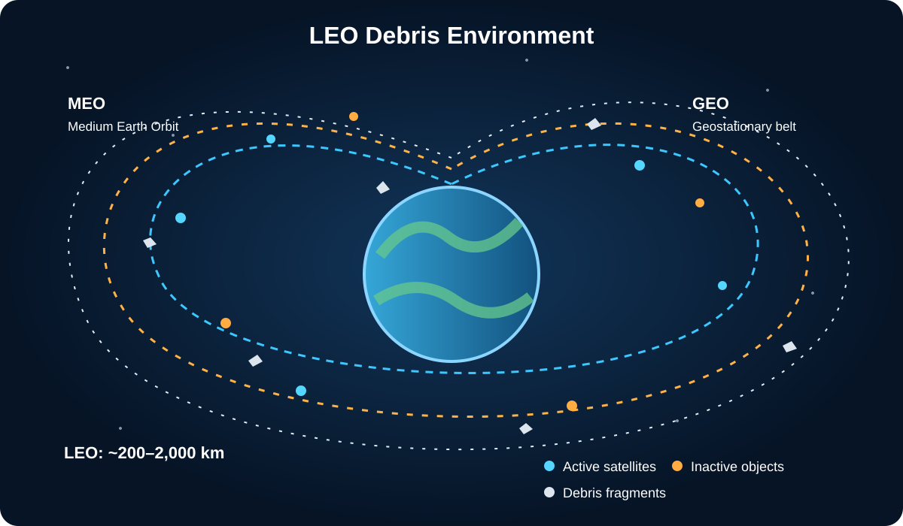

# الفصل الأول: مسرح العمليات — مدار الأرض المنخفض (LEO) وتاريخ تراكم الحطام الفضائي

 > **ORBITAL-AI · Engineering Book · Chapter 1 of 6**

[← Book home](../../README.md) · [Next chapter](../ch02_space_surveillance_and_sp_catalog/chapter_02.md)

---

## موقع هذا الفصل في الرحلة

نبدأ من المشهد الكبير: المدار الأرضي المنخفض ليس فراغًا ساكنًا، بل بيئة تشغيلية مزدحمة تتحرك فيها الأجسام بسرعات عالية. يضع هذا الفصل المشكلة الفيزيائية والتاريخية والبيئية التي تجعل تفادي الاصطدام ضرورة هندسية.

سلسلة هندسة تفادي الاصطدام الفضائي والذكاء الاصطناعي المداري (ESA Collision Avoidance & Orbital AI) الإصدار المرجعي الموسع — الجزء الأول: الأسس الفيزيائية، الجغرافيا المدارية، والحوكمة البيئية

مدخل الفصل والمنهجية الهندسية: حين ترفع رأسك إلى السماء في ليلة صافية، يخيل إليك أن الفضاء المحيط بكوكبنا محيط أسود هادئ، تسبح فيه الأقمار الصناعية في سكينة تامة. غير أن هذا المشهد الشاعري يخفي وراءه حقيقة فيزيائية وهندسية بالغة التعقيد؛ فنحن لا نعيش تحت سماء فارغة، بل تحت بيئة تشغيلية ديناميكية فائقة السرعة، تنطلق فيها آلاف الأجسام المفهرسة وملايين الشظايا المعدنية بسرعات تتجاوز سرعة رصاصة البندقية بعشر إلى خمس عشرة مرة، بلا إشارات مرور، وبلا مكابح ميكانيكية. يفتح هذا الفصل أبواب مسرح العمليات الذي تدور فيه معركة وكالة الفضاء الأوروبية (ESA Space Environment Report) ومكتب برنامج الحطام المداري بوكالة ناسا (NASA ODPO)، ويروي القصة الكاملة — بالفيزياء الدقيقة، والاشتقاقات الرياضية، والأرقام الموثقة، والتاريخ التشغيلي — لكيفية تحول مدار الأرض المنخفض (Low Earth Orbit — LEO) من بوابة البشرية نحو الكون إلى بيئة حرجة عالية المخاطر تهدد استدامة الأنشطة الفضائية، مع التمييز المنهجي الصارم بين الأجسام المفهرسة فردياً، والتقديرات الإحصائية للأجسام الدقيقة، والنماذج التحليلية المستخدمة في ديناميكا الطيران.

### 1.1 مدخل إلى بيئة المدار الأرضي المنخفض (LEO) وتصنيف الأجسام المدارية

يُقصد بالحطام المداري (Orbital Debris أو Space Debris) جميع الأجسام المصنوعة بشرياً التي توجد في مدار حول الأرض ولم تعد تؤدي وظيفة تشغيلية أو علمية مفيدة. ويشمل هذا التعريف الهندسي كلاً من المركبات الفضائية المتوقفة عن العمل، والمراحل الصاروخية العليا المتروكة بعد الإطلاق، والأجسام التشغيلية المنفصلة أثناء نشر الأقمار، والشظايا الناتجة عن الانفجارات الداخلية أو الاصطدامات الفضائية. ويختلف الحطام المداري في منشئه عن النيازك الدقيقة (Micrometeoroids) ذات الأصل الطبيعي الكوني، وإن كان كلاهما يشتركان في تشكيل بيئة المخاطر الجسيمية الفائقة السرعة (MMOD — Micrometeoroids and Orbital Debris).

#### 1.1.1 لماذا أصبح المدار الأرضي المنخفض مورداً استراتيجياً مزدحماً؟

يمثل المدار الأرضي المنخفض (LEO) الشريان الحيوي للحضارة الرقمية والعلمية المعاصرة؛ ففيه تحلق أقمار مراقبة الأرض والمناخ والزراعة (مثل سلسلة أقمار Sentinel ضمن برنامج كوبرنيكوس الأوروبي)، وفيه تسبح المحطات الفضائية المأهولة (ISS ومحطة Tiangong)، وعبره تمر كوكبات الاتصالات والإنترنت الفضائي الحديثة. وتنبع صعوبة إدارة هذه البيئة الفضائية من اجتماع ثلاثة عوامل فيزيائية حاكمة:

السرعات النسبية الكيلومترية: حيث تتحرك الأجسام بسرعات مدارية تقارب $7.5$ إلى $7.8\text{ km/s}$، وتتواجه بسرعات نسبية تصل في المتوسط إلى $10\text{–}11.6\text{ km/s}$ وتبلغ في المواجهات المتعاكسة نحو $15\text{ km/s}$.

التفاوت الهائل في الأحجام وقابلية الرصد: حيث تتجاور أقمار تزن أطناناً مع شظايا سنتيمترية ومليمترية يصعب تتبعها فردياً بالرادارات الأرضية الروتينية.

الديناميكية المستمرة للمدارات: حيث لا تبقى المدارات ثابتة كخطوط السكك الحديدية، بل تتغير باستمرار تحت تأثير تفلطح الأرض ($J_2$)، وتقلبات السحب الجوي في طبقة الثيرموسفير، وضغط الإشعاع الشمسي، ونشاط الدورة الشمسية.

*الشكل (1-1): الخريطة الذهنية المعمارية للفصل الأول: تصنيف الأجسام المدارية، المناطق المحمية دولياً، الأحداث التاريخية المفصلية، مقاييس تطور البيئة الفضائية، ومعايير التخفيف والامتثال — عرض الخريطة بدقة كاملة على Google Drive.*

#### 1.1.2 التصنيف القياسي للأجسام المدارية في فهارس المراقبة (ESA / DISCOS Object Classifications)

تضع قاعدة بيانات معلومات الحطام الفضائي التابعة لوكالة الفضاء الأوروبية (DISCOS) والتقرير السنوي لبيئة الفضاء (ESA Space Environment Report) تصنيفاً قياسياً صارماً لكافة الأجسام الموجودة في الفضاء، وهو التصنيف الذي ينعكس مباشرة في العمود الفئوي c_object_type داخل بيانات رسائل التحذير (CDM):

الحمولات الفضائية (Payloads — PL): وتشمل الأقمار الصناعية والمركبات الفضائية المصممة لأداء مهمة محددة (علمية، اتصالات، أرصاد، ملاحة)، سواء كانت لا تزال نشطة وعاملة أو انتهت مهمتها وتحولت إلى حمولات خاملة. وتُعرّف الكوكبة الفضائية (Constellation) في منهجية وكالة الفضاء الأوروبية بأنها مجموعة تضم 10 حمولات على الأقل أُطلقت لتحقيق هدف تشغيلي مشترك تحت بنية تحكم موحدة.

هياكل الصواريخ (Rocket Bodies — RB): وتشمل المراحل الصاروخية العليا (Upper Stages) التي استُخدمت لحقن الأقمار الصناعية في مداراتها النهائية ثم انفصلت عنها وبقيت تسبح في المدار.

الأجسام المتعلقة بالمهمة (Mission-Related Objects — MRO): وهي الأجزاء الهندسية التي تنفصل عمداً أو تشغيلياً أثناء عملية النشر والوضع في المدار، مثل أغطية العدسات الحساسة (Lens Covers)، وأحزمة الفصل الميكانيكية (Yo-Yo De-spin Weights & Clamp Bands)، والمحولات البنيوية للحمولات المزدوجة (Dual-Payload Adapters).

فئات الحطام والتفتت (Debris Classes): وتشمل ثلاث عائلات فرعية: حطام الحمولات (Payload Debris)، وحطام الصواريخ (Rocket Debris)، وحطام التفتت والانفجارات (Fragmentation Debris) الناتج عن الانفجارات الداخلية أو التصادمات، وهو الذي يمثل الأغلبية الساحقة من الشظايا المدارية.

#### 1.1.3 هرم أعداد الحطام الفضائي وحدود الرصد الهندسي

تتفق التقديرات الإحصائية الصادرة عن مكتب برنامج الحطام المداري بوكالة ناسا (NASA ODPO FAQ) ونموذج البيئة الفضائية الأوروبي (MASTER-8) على أن الأجسام المفهرسة في الكتالوجات العامة لا تمثل سوى قمة جبل الجليد المداري، بينما يتوزع مجتمع الحطام الكلي في هرم رباعي الطبقات حسب القطر الهندسي وقابلية الرصد:

جدول (1-1): تصنيف الأجسام المدارية وفئات الحطام الفضائي بحسب القطر الهندسي وقابلية التتبع والخطورة التشغيلية.

| فئة الحجم التقريبية | العدد المقدر في المدار (تقديرات ESA / NASA) | وضع الرصد والتتبع الأرضي | المعالجة الهندسية والأثر التدميري عند الاصطدام |
| --- | --- | --- | --- |
| أكبر من 10 سم (> 10 cm) (Tracked Cataloged Objects) | أكثر من 36,500 إلى 40,000 جسم مفهرس | تُرصد وتُتتبع بصورة فردية منتظمة بواسطة شبكات الرادار والتلسكوبات | تدخل في كتالوجات المدارات وتُنتج رسائل التحذير CDM لتنفيذ مناورات الهروب؛ اصطدامها يعني تدميراً وتبخيراً كاملاً للمركبة وإنتاج آلاف الشظايا |
| من 1 سم إلى 10 سم (1 – 10 cm) (Lethal Non-Cataloged Debris) | نحو 1,000,000 (مليون) شظية تقريباً | يصعب تتبع معظمها روتينياً في الكتالوجات التقليدية (باستثناء قدرات المسح الخاص كـ Space Fence) | المنطقة العمياء الأخطر: أكبر من قدرة دروع الحماية المادية (Whipple Shields)، وأصغر من التتبع الروتيني للمناورة؛ تمتلك طاقة قنبلة يدوية (~95 kJ) تخترق القمر وتفجر خزاناته |
| من 1 مم إلى 1 سم (1 mm – 1 cm) (Sub-centimeter Particles) | أكثر من 130,000,000 (130 مليون) جسيم | غير قابلة للتتبع الفردي إطلاقاً؛ تُدرس إحصائياً عبر نماذج البيئة مثل MASTER-8 و ORDEM | تُعالج هندسياً عبر التدريع المادي (Shielding) وتقوية الهياكل؛ قد تسبب ثقوباً موضعية، أو تدمير الكابلات والأنابيب الحرارية والعدسات |
| أصغر من 1 مم (< 1 mm) (Micro-debris & Paint Flakes) | تريليونات الجسيمات الدقيقة ورقائق الطلاء وأكسيد الألومنيوم | تُقاس عبر ألواح الاختبار المسترجعة ومستشعرات التصادم السطحي | تسبب تآكلاً مستمراً للأسطح البصرية، وتدهور كفاءة الألواح الشمسية، وخدوش نوافذ المركبات المأهولة |

### 1.2 المناطق المدارية المحمية دولياً وإطار الاستدامة المدارية

إدراكاً لحقيقة أن المدارات الفضائية المحيطة بالأرض مورد طبيعي محدود لا يتجدد ذاتياً في الارتفاعات العالية، وضعت لجنة التنسيق المشتركة بين الوكالات بشأن الحطام الفضائي (IADC — Inter-Agency Space Debris Coordination Committee) في إرشاداتها القياسية (IADC Space Debris Mitigation Guidelines, Rev. 2)، وتبعتها وكالة الفضاء الأوروبية في معيارها الحديث (ESA ESSB-ST-U-007)، تعريفاً هندسياً وقانونياً صارماً لما يُعرف بـ المناطق المدارية المحمية دولياً (IADC Protected Regions).

#### 1.2.1 الهندسة المكانية للمنطقتين المحميتين (Region A — LEO و Region B — GEO)

تُقسّم الفضاءات المدارية ذات القيمة الاستراتيجية القصوى حول الأرض إلى منطقتين محميتين يحظر تلويثهما أو ترك الأجسام الخاملة فيهما لفترات طويلة:

المنطقة المحمية أ — المدار الأرضي المنخفض (Region A: LEO Protected Region): وهي قشرة كروية متمركزة حول الأرض تمتد من سطح البحر ($h = 0\text{ km}$) وحتى ارتفاع $h = 2,000\text{ km}$. وتضم هذه المنطقة الغالبية العظمى من البنية التحتية الفضائية النشطة، كما تمثل المسرح الكامل لبيانات مسابقة وكالة الفضاء الأوروبية (ESA Collision Avoidance Challenge).

المنطقة المحمية ب — المدار المتزامن مع الأرض (Region B: GEO Protected Region): وهي حلقة طوقية تحيط بحزام كلارك الجغرافي الثابت ($h_{\text{GEO}} = 35,786\text{ km}$ فوق خط الاستواء) وتمتد بسمك قدره $\pm 200\text{ km}$ في الارتفاع (أي من ارتفاع $35,586\text{ km}$ إلى $35,986\text{ km}$) وبعرض زاوي قدره $\pm 15^\circ$ في خط العرض الجغرافي شمال وجنوب خط الاستواء، لحماية أقمار البث التلفزيوني والاتصالات الاستراتيجية والإنذار المبكر، مع تخصيص المدارات التي تعلو هذا النطاق بنحو $300\text{ km}$ لتكون «مدارات مقبرة» (Graveyard Orbits).

*الشكل (1-2): التقسيم الهندسي لنطاقات الارتفاع داخل منطقة المدار الأرضي المنخفض المحمية (LEO: 0 – 2,000 km) وتفاوت كثافة الغلاف الجوي والوظائف التشغيلية عبر الطبقات.*

جدول (1-2): المواصفات الهندسية والتشغيلية للمناطق المدارية المحمية وفق إرشادات IADC ومعيار ESA ESSB-ST-U-007.

| المنطقة المحمية | حدود الارتفاع الهندسي ($h$) | نطاق خط العرض ($\phi$) | الأصول الفضائية الحيوية داخل المنطقة | استراتيجية الإخلاء القياسية بعد انتهاء المهمة (PMD) |
| --- | --- | --- | --- | --- |
| المنطقة المحمية LEO (Region A) | من سطح الأرض ($0\text{ km}$) حتى $2,000\text{ km}$ | تغطية كروية شاملة ($-90^\circ$ إلى $+90^\circ$) | أقمار مراقبة الأرض (Sentinel)، المحطات المأهولة (ISS)، كوكبات الاتصالات (Starlink, OneWeb) | خفض الحضيض المداري لإعادة الدخول في الغلاف الجوي والاحتراق (خلال $\le 25$ سنة تقليدياً، وخلال $\le 5$ سنوات وفق ميثاق Zero Debris الحديث) |
| المنطقة المحمية GEO (Region B) | $35,786\text{ km} \pm 200\text{ km}$ ($35,586\text{–}35,986\text{ km}$) | شريط استوائي بعرض $\pm 15^\circ$ شمال وجنوب خط الاستواء | أقمار الاتصالات السيادية، البث الفضائي، وأقمار الأرصاد الجوية الثابتة (Meteosat) | الرفع المداري (Super-synchronous Re-orbiting) إلى مدار مقبرة يعلو حزام GEO بما لا يقل عن $\Delta H = 235 + 1000 \cdot C_R (A/m)\text{ km}$ |

### 1.3 فيزياء السرعات الفائقة (Hypervelocity Impact Physics) ودروع الحماية

لكي ندرك لماذا لا توجد «حوادث اصطدام بسيطة» في المدار الأرضي المنخفض، دعنا نقارن بين الفيزياء التي نختبرها على الطرق السريعة على الأرض وبين الفيزياء التي تحكم الفضاء القريب. عندما تصطدم سيارتان على الأرض بسرعة $100$ أو $150\text{ km/h}$، فإن الطاقة الحركية تُمتص عبر انبعاج الصاج المعدني وتهشم الزجاج خلال أعشار من الثانية. أما في المدار الأرضي المنخفض (LEO)، فإن قوانين الميكانيكا السماوية تفرض سرعات تجعل قطعة معدنية بحجم حبة العنب تمتلك طاقة تفجيرية تضاهي قذيفة مدفعية.

#### 1.3.1 الاشتقاق الرياضي للسرعة المدارية والسرعة النسبية لحظة المواجهة

يقع المدار الأرضي المنخفض (160 km إلى 2,000 km) في قلب البئر الجاذبي لكوكب الأرض. ولكي يظل أي قمر صناعي معلقاً في مداره الدائري دون أن يسقط محترقاً نحو الأرض، يجب أن تتعادل قوة الجذب المركزي للأرض مع قوة الطرد المركزي الناتجة عن حركته الأفقية:

$$\frac{G M_E m}{r^2} = \frac{m v_{\text{orb}}^2}{r} \quad \Longrightarrow \quad v_{\text{orb}} = \sqrt{\frac{\mu}{r}} = \sqrt{\frac{G M_E}{R_E + h}}$$

حيث:

$\mu = G M_E \approx 3.986004418 \times 10^5\text{ km}^3/\text{s}^2$: معامل الجاذبية القياسي للأرض (Earth Standard Gravitational Parameter).

$R_E \approx 6378.137\text{ km}$: نصف القطر الاستوائي المرجعي للأرض.

$h$: ارتفاع القمر الصناعي فوق سطح الأرض (عند ارتفاع $h = 800\text{ km}$ يكون نصف قطر المدار $r = R_E + h \approx 7178.14\text{ km}$).

بتعويض هذه القيم الفيزيائية، نجد أن السرعة المدارية لأي جسم يحلق على ارتفاع $800\text{ km}$ تبلغ:

$$v_{\text{orb}} = \sqrt{\frac{398600.44}{7178.14}} \approx 7.45\text{ km/s} \quad (\text{وتصل إلى } 7.80\text{ km/s عند ارتفاع } 200\text{ km، أي قرابة } 28,000\text{ km/h})$$

غير أن الخطر الحقيقي لا يكمن في سرعة الجسم الواحد، بل في السرعة النسبية للارتطام (Relative Impact Speed — العمود relative_speed في جدول بيانات CDM)! فعندما يتحرك القمر الهدف بسرعة متجهة $\vec{v}_1$ وتتحرك شظية الحطام المقابلة بسرعة متجهة $\vec{v}_2$ في مدارين يتقاطع مستوياهما بزاوية تقاطع فضائية $\phi$، فإن مقدار السرعة النسبية لحظة الاقتراب الأقصى (TCA) يُعطى بمعيار الفرق المتجهي الكامل:

$$v_{\text{rel}} = |\vec{v}_2 - \vec{v}_1| = \sqrt{v_1^2 + v_2^2 - 2 v_1 v_2 \cos(\phi)}$$

وفي الحالة الشائعة التي يدور فيها الجسمان في مدارين شبه دائريين على الارتفاع نفسه تقريباً ($v_1 \approx v_2 = v_{\text{orb}}$)، تتبسط هذه العلاقة عبر المتطابقات المثلثية إلى الصيغة الهندسية الشهيرة:

$$v_{\text{rel}} \approx 2 v_{\text{orb}} \sin\left(\frac{\phi}{2}\right)$$

هذه المعادلة تكشف حقيقة هندسية حاسمة: إذا تقاطع جسمان في مدارين قطبيين أو متزامنين مع الشمس يتحركان في اتجاهين متعاكسين عند القطبين (حيث تقترب زاوية التقاطع $\phi$ من $100^\circ$ إلى $180^\circ$)، فإن $\sin(\phi/2) \to 1$، فتتضاعف السرعة النسبية لتصل في المتوسط إلى $10\text{–}11.6\text{ km/s}$ ($41,760\text{ km/h}$)، وتبلغ في المواجهات الأمامية المباشرة (Head-on Encounters) نحو $15\text{ km/s}$ ($54,000\text{ km/h}$)، أي نحو 12 إلى 16 ضعف سرعة طلقة البندقية الحربية ($0.9\text{ km/s}$)!

#### 1.3.2 طاقة الارتطام فائق السرعة وظاهرة التفتت الكارثي (Catastrophic Fragmentation)

تتناسب الطاقة الحركية $E_k$ المتحررة لحظة الاصطدام طردياً مع الكتلة $m$ ومع مربع السرعة النسبية $v_{\text{rel}}^2$:

$$E_k = \frac{1}{2} m v_{\text{rel}}^2$$

وبسبب تربيع السرعة في هذه العلاقة، فإن الأجسام الصغيرة جداً تتحول إلى قنابل طاقة مركزة:

كرة ألومنيوم بقطر $1\text{ cm}$ فقط: تبلغ كتلتها نحو $m \approx 1.4\text{ g} = 0.0014\text{ kg}$. عند اصطدامها بسرعة نسبية $v_{\text{rel}} = 11.6\text{ km/s} = 11,600\text{ m/s}$، تكون طاقتها الحركية: $$E_k = 0.5 \times 0.0014 \times (11,600)^2 \approx 94,192\text{ J} \approx 95\text{ kJ}$$ وهي طاقة تعادل انفجار قنبلة يدوية عسكرية (Hand Grenade) أو صدمة سيارة مسرعة تزن طناً كاملاً ترتطم بجدار خرساني!

شظية حطام بقطر $10\text{ cm}$ وكتلة $1\text{ kg}$: عند سرعة نسبية $11.6\text{ km/s}$، تطلق طاقة نوعية مقدارها: $$E_k = 0.5 \times 1.0 \times (11,600)^2 = 67.28\text{ MJ}$$ وبما أن كيلوجراماً واحداً من مادة الـ TNT شديدة الانفجار يطلق نحو $4.184\text{ MJ}$، فإن شظية واحدة تزن كيلوجراماً واحداً تعادل انفجار 16 كيلوجراماً من الـ TNT!

*الشكل (1-3): مقارنة الطاقة الحركية عند السرعات الفائقة (Hypervelocity) بين مركبة أرضية ورصاصة بندقية وشظية مدارية، إلى جانب هرم وكالة الفضاء الأوروبية لتوزيع أعداد الحطام الفضائي — عرض الشكل بدقة كاملة على Google Drive.*

*الشكل (1-4): المنحنى الفيزيائي اللوغاريتمي لنمو الطاقة الحركية المتحررة (بالجول) كدالة في كتلة المقذوف المداري عند سرعة اصطدام مرجعية قدرها $10\text{ km/s}$.*

في فيزياء المواد والديناميكا الحرارية، عندما تتجاوز سرعة الارتطام ($10\text{–}15\text{ km/s}$) سرعة انتشار الموجات الصوتية الميكانيكية داخل معدن الألومنيوم أو التيتانيوم (حوالي $5\text{ to } 6\text{ km/s}$)، يعجز الهيكل المعدني عن تصريف الطاقة عبر الانثناء اللدن. بدلاً من ذلك، تتولد موجة صدمية فائقة الضغط (Hypervelocity Shockwave) ترفع درجة الحرارة والضغط في أجزاء من المليون من الثانية إلى عشرات الجيجا باسكال، فينصهر ويتبخر جزء من المعدن إلى بلازما، ويتفتت الجسم الهدف بالكامل إذا تجاوزت نسبة طاقة المقذوف إلى كتلة الهدف العتبة الحرجة البالغة $40\text{ J/g}$ ($40\text{ kJ/kg}$) وفق نموذج الانفجار القياسي لوكالة ناسا (NASA Standard Breakup Model — EVOLVE 4.0)، وهي الظاهرة التي تُعرف هندسياً باسم التفتت الكارثي (Catastrophic Fragmentation).

#### 1.3.3 دروع «ويبل» (Whipple Shields) وحدود الحماية المادية

لحماية المركبات المأهولة (مثل وحدات محطة الفضاء الدولية ISS) والأقمار الحيوية من الجسيمات المليمترية، ابتكر عالم الفلك فريد ويبل (Fred Whipple) عام 1947 تصميم درع الحماية متعدد الطبقات المعروف باسم درع ويبل (Whipple Shield):

مبدأ العمل الفيزيائي: بدلاً من استخدام جدار معدني واحد سميك وثقيل يخترقه المقذوف مباشرة، يتكون درع ويبل من طبقة خارجية رقيقة من الألومنيوم تُسمى المصد الأمامي (Sacrificial Bumper)، تفصلها مسافة فراغية (Stand-off Distance تتراوح بين $10$ إلى $30\text{ cm}$) عن الجدار الخلفي الرئيسي للمركبة (Rear Pressure Wall)، مع حشو الفراغ في التصاميم المتقدمة (Stuffed Whipple Shield)بطبقات من ألياف الكيفلار (Kevlar) والنيكستل (Nextel) المقاومة للحرارة.

تفتيت المقذوف إلى سحابة بلازما: عندما تصطدم شظية صغيرة (أقل من $1\text{ cm}$) بالمصد الخارجي الرقيق بسرعة $10\text{ km/s}$، فإن الصدمة الفائقة تفتت الشظية وتصهرها وتحولها إلى سحابة متمددة من القطرات المنصهرة والغازات، فتتوزع طاقة الصدمة على مساحة واسعة من الجدار الخلفي بدلاً من تركزها في نقطة ثقبية واحدة.

حدود الفشل الهندسي: تتوقف قدرة دروع ويبل تماماً أمام الشظايا التي يتجاوز قطرها $1\text{ cm}$ إلى $2\text{ cm}$؛ فوزن الدروع اللازمة لصد شظية بحجم $2\text{ cm}$ سيجعل القمر الصناعي أثقل من أن يستطيع أي صاروخ حمله إلى المدار! ومن هنا تنشأ القاعدة الذهبية لسلامة الفضاء: ندير الدروع للحماية مما لا نراه ($< 1\text{ cm}$)، وندير المحركات للمناورة والهروب مما نراه ($> 10\text{ cm}$)، بينما تظل الشظايا بين $1$ و$10\text{ cm}$ هي التهديد الأخطر الذي يتطلب تطوير رادارات الجيل الجديد ونماذج الذكاء الاصطناعي.

### 1.4 الجغرافيا المدارية: لماذا تتكدس الأقمار والشظايا في أنفاق محددة؟

قد يتبادر إلى الذهن تساؤل منطقي: إذا كانت مساحة سطح الكرة المدارية المحيطة بالأرض على ارتفاع $800\text{ km}$ تبلغ $4\pi (R_E + h)^2 \approx 647\text{ million km}^2$ (أي أكثر من مساحة الكرة الأرضية نفسها)، فلماذا تصطدم مركبتان صغيرتان لا يتجاوز عرض الواحدة منهما بضعة أمتار؟

الإجابة تكمن في الجغرافيا المدارية غير المتجانسة: الأقمار الصناعية لا تتوزع عشوائياً في الفضاء الثلاثي، بل تُجبرها قوانين الفيزياء ومتطلبات المهام الفضائية على التراكم في نطاقات ارتفاع وزوايا ميل محددة للغاية.

#### 1.4.1 العناصر المدارية الكبلرية الستة (Six Keplerian Orbital Elements)

لتحديد مدار أي جسم في الفضاء وحركته اللحظية في إطار مرجعي قصوري (مثل إطار EME2000 / J2000 المعتمد في بيانات CDM)، نستخدم ستة عناصر هندسية كبلرية:

نصف المحور الأكبر ($a$ — Semi-Major Axis): يحدد حجم المدار وطاقته الميكانيكية الكلية ($\mathcal{E} = -\mu / 2a$) وزمن دورته المدارية ($T = 2\pi\sqrt{a^3/\mu}$)، ويظهر في بياناتنا في العمودين t_j2k_sma و c_j2k_sma.

الاختلاف المركزي أو الشذوذ المداري ($e$ — Eccentricity): يحدد شكل المدار (حيث $e = 0$ مدار دائري تماماً، و$0 < e < 1$ مدار إهليلجي بيضاوي)، ويظهر في العمودين t_j2k_ecc و c_j2k_ecc، ومنه يُحسب ارتفاع الأوج $h_{\text{apo}} = a(1+e) - R_E$ (x_h_apo) وارتفاع الحضيض $h_{\text{per}} = a(1-e) - R_E$ (x_h_per).

زاوية الميل المداري ($i$ — Inclination): الزاوية المحصورة بين مستوى المدار ومستوى خط الاستواء الأرضي ($0^\circ \le i \le 180^\circ$)، وتظهر في العمودين t_j2k_inc و c_j2k_inc.

خط طول العقدة الصاعدة ($\Omega$ — Right Ascension of the Ascending Node — RAAN): الزاوية التي تحدد دوران مستوى المدار في الفضاء حول محور دوران الأرض.

حجة الحضيض ($\omega$ — Argument of Perigee): الزاوية التي تحدد اتجاه أقرب نقطة في المدار داخل مستوى المدار نفسه.

الشذوذ الحقيقي أو المتوسط ($\nu$ أو $M$ — True / Mean Anomaly): يحدد موضع الجسم اللحظي على مساره المداري.

#### 1.4.2 فيزياء المدار المتزامن مع الشمس (SSO) وانجراف تفلطح الأرض ($J_2$)

تحتاج معظم أقمار مراقبة الأرض والتصوير البيئي والراداري (مثل أسطول وكالة الفضاء الأوروبية Sentinel-1, Sentinel-2, Sentinel-3, و CryoSat-2) إلى تحقيق شرطين هندسيين معاً:

التغطية العالمية الشاملة: المرور فوق كافة خطوط العرض من القطب الشمالي إلى القطب الجنوبي، مما يستلزم زاوية ميل قريبة من $90^\circ$ (Near-Polar Orbit).

ثبات التوقيت الشمسي المحلي (Constant Local Solar Time): المرور فوق أي بقعة جغرافية على الأرض في نفس الساعة الشمسية المحلية يومياً (مثلاً الساعة 10:30 صباحاً)، بحيث تكون زاوية سقوط أشعة الشمس وطول الظلال متطابقة عند مقارنة صور الأمازون أو الجليد القطبي عبر الشهور والسنوات.

لو كانت الأرض كرة متجانسة تماماً، لظل مستوى مدار القمر ثابتاً في الفضاء النجمي القصوري (Inertial Space)، ومع دوران الأرض حول الشمس بمقدار $360^\circ$ كل $365.2422$ يوماً، كان التوقيت المحلي لمرور القمر سينزاح بمقدار $24$ ساعة على مدار العام! غير أن مهندسي الميكانيكا المدارية استغلوا حقيقة أن الأرض منبعجة عند خط الاستواء ومفلطحة عند القطبين بفعل دورانها حول محورها (نصف القطر الاستوائي أكبر من القطبي بنحو $21.38\text{ km}$). ويُعبّر عن هذا الانبعاج الاستوائي في متسلسلة التوافقيات الكروية للجاذبية الأرضية عبر معامل التفلطح الجاذبي الثاني ($J_2$) (ESA Types of Orbits):

$$J_2 \approx 1.08262668 \times 10^{-3}$$

يمارس هذا الحزام الاستوائي عزماً جاذبياً يجعل مستوى المدار بأكمله يترنح ويدور حول محور الأرض (Nodal Precession) بمعدل زمني متوسط $\dot{\Omega}$ تحكمه معادلة لاغرانج الكوكبية:

$$\dot{\Omega} = -\frac{3}{2} J_2 , n \left( \frac{R_E}{a(1 - e^2)} \right)^2 \cos(i)$$

ولكي يتطابق معدل دوران مستوى المدار $\dot{\Omega}$ مع معدل دوران الأرض الظاهري حول الشمس شرقاً، يجب أن يتحقق شرط التزامن الشمسي (Sun-Synchronous Condition):

$$\dot{\Omega}_{\text{SSO}} = +\frac{360^\circ}{365.2422\text{ days}} = +0.985647^\circ/\text{day} \approx 1.991 \times 10^{-7}\text{ rad/s}$$

وبما أن المقدار $-\frac{3}{2} J_2 n \left(\frac{R_E}{a(1-e^2)}\right)^2$ سالب دائماً، فلن نحصل على دوران موجب (نحو الشرق) إلا إذا كانت قيمة $\cos(i) < 0$، أي أن زاوية الميل $i$ يجب أن تكون زاوية منفرجة أكبر من $90^\circ$ (Retrograde Near-Polar Orbit). وعند ارتفاعات الرصد النموذجية بين $700$ و$850\text{ km}$، تفرض هذه المعادلة على جميع أقمار العالم المتزامنة مع الشمس أن تتكدس في شريط ميل ضيق للغاية:

$$i_{\text{SSO}} \approx 98.2^\circ \text{ to } 98.9^\circ \quad (\text{مثلاً } 98.6^\circ \text{ عند ارتفاع } 800\text{ km})$$

#### 1.4.3 تداخل المسارات عند خطوط العرض العليا ولغز «الفجوة القطبية» (The Polar Hole & Weibull Tail)

توضح الورقة المرجعية الرسمية لتحدي وكالة الفضاء الأوروبية (Uriot et al., 2021 — Figures 1, 2, 3) الأثر الهندسي المباشر لهذا التكدس:

حد أقصى لخط العرض والفجوة القطبية (Polar Gap): عندما يدور قمر صناعي بزاوية ميل $i = 98.6^\circ$، فإن أقصى خط عرض جيومركزي (geocentric_latitude) يصل إليه شمالاً أو جنوباً هو $\phi_{\max} = 180^\circ - 98.6^\circ = 81.4^\circ$. وهذا يعني أنه لا يمر مباشرة فوق نقطة القطب ($90^\circ$)، بل يلتف عائداً عند خط العرض $81.4^\circ$، تاركاً دائرة قطبية خالية من مدارات SSO نصف قطرها $8.6^\circ$.

منطقة التداخل الهندسي عند حافة الانعطاف (High-Latitude Conjunction Zone 78°–82°): بينما تكون مستويات مدارات SSO المختلفة (ذات زوايا $\Omega$ المتباينة) متباعدة عن بعضها بمئات الكيلومترات عند عبورها فوق خط الاستواء، فإنها تتقارب هندسياً كلما اتجهت نحو القطبين وتتشابك مساراتها بكثافة عند حافة الانعطاف ($\phi \in [78^\circ, 82^\circ]$ شمالاً وجنوباً). هذا التداخل الهندسي والزمني للمسارات عالية الميل هو السبب الفيزيائي لتركز نسبة هائلة من تحذيرات الـ CDM في بيانات وكالة الفضاء الأوروبية عند خطوط العرض العليا، مع التأكيد الهندسي على أن التقارب الفعلي يتطلب تزامناً في الارتفاع والطور الزمني لحظة العبور وليس مجرد تقاطع مسقطين ثنائيي الأبعاد.

توزيع فيبول للقيم المتطرفة الصغرى (Weibull Distribution of Miss Distance): لأن مسافة العبور الدنيا (miss_distance) تمثل أصغر مسافة مسجلة بين القمر والشظايا العابرة لحيز الحماية، فإن توزيعها الإحصائي حول أقمار مثل Sentinel-3B يتبع قانون القيم المتطرفة الصغرى لفيبول:

$$f(d; k, \lambda) = \frac{k}{\lambda} \left(\frac{d}{\lambda}\right)^{k-1} \exp\left[-\left(\frac{d}{\lambda}\right)^k\right], \quad d \ge 0$$

*الشكل (1-5): اللوحة (A) المنظور القطبي ثلاثي الأبعاد لمدارات SSO بميل $98.6^\circ$ وحلقة التقاطع الحرجة (78°–82°) حول الفجوة القطبية، اللوحة (B) ذروة الكثافة المكانية للحطام بين 750–1,000 km وقرب 1,400 km من نموذج ESA MASTER-8، واللوحة (C) المدرج التكراري للمسافات الفاصلة حول Sentinel-3B ومنحنى Weibull — عرض الشكل بدقة كاملة على Google Drive.*

### 1.5 الحوادث التاريخية الكبرى وبصمتها المدارية على مخططات غابارد (Gabbard Diagrams)

لم يتراكم الحطام الفضائي في المدار الأرضي المنخفض بوتيرة خطية هادئة، بل شهد قفزات حادة ناتجة عن أحداث تفتت كبرى (Major Breakup Events). وإلى جانب التجمعات التاريخية في نطاقات $750\text{–}1,000\text{ km}$ ونطاق $1,400\text{ km}$، غيّرت ثلاث حوادث كبرى في القرن الحادي والعشرين شكل البيئة المدارية للأبد.

#### 1.5.1 حادثة تدمير القمر الصيني Fengyun-1C (11 يناير 2007)

في 11 يناير 2007، أُجري اختبار لسلاح مضاد للأقمار الصناعية بالصعود المباشر (Direct-Ascent ASAT) استهدف القمر الصيني المتقاعد للأرصاد الجوية Fengyun-1C (كتلته $750\text{ kg}$)، أثناء تحليقه في مدار قطبي متزامن مع الشمس على ارتفاع $865\text{ km}$.

حصيلة التفكك: وفقاً لتقارير مكتب برنامج الحطام المداري بناسا (NASA NTRS 20070007324 و Liou & Johnson, 2008) وبيانات CelesTrak، أنتج هذا الارتطام الحركي المباشر أكبر سحابة حطام من حدث واحد في تاريخ الفضاء: أكثر من 3,312 إلى 3,549 شظية كبيرة مفهرسة ($> 10\text{ cm}$)، وما يُقدّر بأكثر من 150,000 شظية يزيد قطرها عن $1\text{ cm}$.

الارتداد التشغيلي: في غضون عام واحد من الحادث، سجلت أنظمة الرصد أكثر من 3,000 اقتراب وثيق ضمن مسافة $5\text{ km}$ مع أقمار عاملة في أسبوع واحد، واضطرت وكالة ناسا لتنفيذ مناورة طارئة لقمرها العلمي TERRA لتفادي احتمال تصادم مرتفع للغاية مع إحدى شظايا Fengyun-1C.

#### 1.5.2 حادثة التصادم العرضي بين Iridium 33 و Cosmos 2251 (10 فبراير 2009)

في 10 فبراير 2009 (الساعة 16:55:59.8 UTC)، وقع أول تصادم فضائي عرضي مباشر فائق السرعة بين قمرين صناعيين كاملين فوق شمال سيبيريا على ارتفاع $789\text{ km}$ (NASA ODQN Vol. 13, Issue 2 و Johnson, 2010):

الأطراف المتصادمة: القمر الأمريكي التجاري العامل Iridium 33 (كتلته $560\text{ kg}$، ميل مداره $86.4^\circ$)، والقمر العسكري الروسي الخامل Cosmos 2251 (كتلته $950\text{ kg}$، ميل مداره $74.0^\circ$، وكان متوقفاً عن العمل منذ عام 1995).

السرعة النسبية والنتيجة: تقاطع المستويان المداريان بزاوية قاربت الزاوية القائمة، فارتطم القمران بسرعة نسبية بلغت $11.6\text{ km/s}$ ($41,760\text{ km/h}$)، مما أدى إلى تفتت كارثي كامل للقمرين وتوليد أكثر من 2,296 شظية كبيرة مفهرسة في سحابتين متقاطعتين غطتا نطاق الارتفاعات من $200\text{ km}$ إلى $2,000\text{ km}$.

#### 1.5.3 حادثة تدمير القمر Cosmos 1408 (15 نوفمبر 2021)

في 15 نوفمبر 2021، أُجري اختبار آخر مضاد للأقمار الصناعية استهدف القمر السوفيتي القديم الخامل Cosmos 1408 (كتلته نحو $2,200\text{ kg}$) على ارتفاع يقارب $485\text{ km}$، مما ولّد أكثر من 1,500 إلى 1,800 شظية قابلة للتتبع هددت بشكل مباشر مدار محطة الفضاء الدولية (ISS على ارتفاع $\sim 420\text{ km}$) وأجبرت طاقم الرواد على الاحتماء داخل كبسولات العودة وتنفيذ عدة مناورات لتفادي الشظايا.

جدول (1-3): مقارنة هندسية وإحصائية شاملة للحوادث التاريخية الكبرى المولدة للحطام في المدار الأرضي المنخفض.

| المعيار الهندسي والتشغيلي | حادثة Fengyun-1C (11 يناير 2007) | حادثة Iridium 33 × Cosmos 2251 (10 فبراير 2009) | حادثة Cosmos 1408 (15 نوفمبر 2021) |
| --- | --- | --- | --- |
| طبيعة الحدث وسببه | تدمير متعمد باختبار صاروخ اعتراض أرضي (ASAT) | أول تصادم عرضي غير مقصود بين قمر عامل وقمر خامل | تدمير متعمد باختبار صاروخ اعتراض أرضي (ASAT) |
| كتلة الأجسام المتفتتة | $\sim 750\text{ kg}$ | $560\text{ kg} + 950\text{ kg} = 1,510\text{ kg}$ | $\sim 2,200\text{ kg}$ |
| الارتفاع المداري وزاوية الميل | $865\text{ km}$ ($i \approx 98.8^\circ$ — مدار SSO) | $789\text{ km}$ ($i_1 = 86.4^\circ, , i_2 = 74.0^\circ$) | $\sim 485\text{ km}$ ($i \approx 82.5^\circ$) |
| السرعة النسبية للارتطام | $\sim 8.0\text{–}9.0\text{ km/s}$ | $11.6\text{ km/s}$ ($41,760\text{ km/h}$) | $\sim 8.0\text{–}10.0\text{ km/s}$ |
| الشظايا المفهرسة رادارياً (> 10 cm) | 3,312 إلى 3,549 شظية (الأكبر تاريخياً) | 2,296 شظية (مجموع السحابتين) | أكثر من 1,500 إلى 1,800 شظية |
| أمد البقاء المداري للسحابة | طويل جداً (79% تبقى لأكثر من 100 عام بسبب الارتفاع الشاهق) | طويل (يمتد لعقود طويلة في حزام $700\text{–}900\text{ km}$) | قصير إلى متوسط (اضمحل معظمها خلال 3–5 سنوات لقربه من الغلاف الجوي) |

#### 1.5.4 القراءة الفيزيائية والرياضية لمخططات «غابارد» (Gabbard Diagrams)

لدراسة البصمة الفيزيائية لأي انفجار أو تصادم مداري، يستخدم خبراء ديناميكا الطيران أداة بصرية كلاسيكية تُسمى مخطط غابارد (Gabbard Diagram)، نسبةً إلى الباحث جون غابارد (John Gabbard) في قيادة الدفاع الجوي لأمريكا الشمالية (NORAD). يرسم هذا المخطط لكل شظية ناتجة عن الانفجار نقطتين على محور رأسي يمثل الارتفاع (Altitude) مقابل محور أفقي يمثل الزمن الدوري المداري (Orbital Period $T$ بالدقائق): نقطة عليا تمثل ارتفاع الأوج (Apogee $h_{\text{apo}}$)، ونقطة سفلى تمثل ارتفاع الحضيض (Perigee $h_{\text{per}}$) على نفس خط الزمن الدوري.

لماذا يرسم مخطط غابارد شكل حرف X مائل فور وقوع الانفجار؟ تفسر معادلة حفظ الطاقة المدارية (Vis-Viva Equation) هذه الهندسة بدقة رياضية تامة:

$$v^2 = \mu \left( \frac{2}{r_0} - \frac{1}{a} \right)$$

حيث $r_0 = R_E + h_0$ هو نصف قطر المدار لحظة الانفجار. عندما ينفجر القمر الصناعي عند النقطة $r_0$، فإن جميع الشظايا تبدأ رحلتها الجديدة من نفس النقطة المكانية $r_0$، أي أن مداراتها الإهليلجية الجديدة لابد أن تمر بارتفاع الانفجار $h_0$:

الفرع الأيمن الصاعد (Posigrade / Forward Impulse $\Delta v_T > 0$): الشظايا التي قُذفت في نفس اتجاه سرعة القمر الأم زادت سرعتها الكلية ($v' = v_0 + \Delta v_T > v_0$)، فزادت طاقتها المدارية وكبُر نصف محورها الأكبر ($a' > r_0$) وطال زمن دورتها المدارية ($T' > T_0$). بالنسبة لهذه الشظايا، تصبح نقطة الانفجار $h_0$ هي أدنى نقطة في مدارها الجديد (الحضيض Perigee ثابت عند $h_0$)، بينما يرتفع أوجها (Apogee) عالياً في الفضاء بزيادة $\Delta v_T$!

الفرع الأيسر الهابط (Retrograde / Backward Impulse $\Delta v_T < 0$): الشظايا التي قُذفت عكس اتجاه حركة القمر الأم انخفضت سرعتها ($v' = v_0 - |\Delta v_T| < v_0$)، فقلّ نصف محورها الأكبر ($a' < r_0$) وقصُر زمن دورتها المدارية ($T' < T_0$). بالنسبة لهذه الشظايا، تصبح نقطة الانفجار $h_0$ هي أعلى نقطة في مدارها الجديد (الأوج Apogee ثابت عند $h_0$)، بينما يهبط حضيضها (Perigee) نحو الغلاف الجوي الأرضي!

تطور المخطط مع الزمن (Claw / Pinch Effect): الشظايا الواقعة في أقصى يسار المخطط (ذات الحضيض المنخفض جداً $h_{\text{per}} < 300\text{ km}$) تصطدم بطبقات الغلاف الجوي الكثيفة فتحترق وتسقط سريعاً، فينحني الذراع الأيسر للمخطط بمرور الشهور والسنوات.

*الشكل (1-6): النمو التراكمي للأجسام الفضائية المفهرسة (1960–2026) مع قفزتي عامي 2007 و2009، إلى جانب مخطط غابارد (Gabbard Diagram) على شكل حرف X لسحابة حطام Fengyun-1C المتمركزة عند ارتفاع 865 km — عرض الشكل بدقة كاملة على Google Drive.*

*الشكل (1-7): مخطط غابارد التحليلي الموضح لتفرع نقاط الأوج (Apogee) والحضيض (Perigee) حول نقطة الانفجار المركزية كدالة في الزمن الدوري المداري بالدقائق.*

### 1.6 ديناميكا الغلاف الجوي، نموذج «جاكيا-روبرتس»، والدورة الشمسية

على الرغم من أن الفضاء على ارتفاع $400$ إلى $800\text{ km}$ يُعامل في الحياة اليومية باعتباره فراغاً، فإنه يضم طبقات الغلاف الجوي الحراري العلوي (الثيرموسفير Thermosphere والإكسوسفير Exosphere). هذا الغاز المتخلخل للغاية يمثل الآلية الطبيعية الوحيدة التي تملكها الأرض لتنظيف مدارها المنخفض من الحطام عبر السحب الجوي (Atmospheric Drag).

#### 1.6.1 المعادلة الباليستية للسحب الجوي ومعدل تبديد الطاقة النوعي (SEDR)

عندما تندفع مركبة فضائية أو شظية حطام بسرعة $v_{\text{rel, atm}}$ عبر جزيئات الغلاف الجوي العلوي ذات الكثافة $\rho(h)$، فإنها تتعرض لقوة إعاقة إيروديناميكية معاكسة لاتجاه حركتها، ينتج عنها تسارع تباطؤ مداري $a_{\text{drag}}$ يُعطى بالمعادلة:

$$a_{\text{drag}} = \frac{1}{2} \rho(h) \left( \frac{C_D A}{m} \right) v_{\text{rel, atm}}^2 = \frac{1}{2} \frac{\rho(h)}{B} v_{\text{rel, atm}}^2$$

حيث:

$\rho(h)$: كثافة الغلاف الجوي عند الارتفاع $h$ بوحدة $\text{kg/m}^3$، وهي تتناقص أُسياً مع الارتفاع وفق مقياس الارتفاع الحراري $H$ (Scale Height): $\rho(h) \approx \rho_0 \exp\left(-\frac{h - h_0}{H}\right)$.

$C_D$: معامل السحب الإيروديناميكي في التدفق الجزيئي الحر (Free-Molecular Flow Drag Coefficient، ويقارب $2.2$ للأجسام الفضائية).

$A / m$: نسبة مساحة المقطع الأمامي المعرض للهواء إلى كتلة الجسم ($\text{m}^2/\text{kg}$).

$\frac{C_D A}{m}$: معامل السحب الباليستي المنسوب للكتلة، وهو العمود الفيزيائي الجوهري الذي يظهر في بيانات CDM تحت الاسمين t_cd_area_over_mass للهدف و c_cd_area_over_mass للمطارد (ويُعرّف مقلوبه $B = \frac{m}{C_D A}$ بالمعامل الباليستي).

معدل تبديد الطاقة النوعي (Specific Energy Dissipation Rate — SEDR): يؤدي هذا الاحتكاك الجوي إلى استنزاف الطاقة الميكانيكية المدارية للجسم بمعدل يُقاس بالواط لكل كيلوجرام ($\text{W/kg}$)، ويظهر مباشرة في العمودين t_sedr و c_sedr:

$$\text{SEDR} = -\frac{d\mathcal{E}}{dt} = \frac{\mu}{2a^2}\left|\frac{da}{dt}\right| \approx \frac{1}{2} \rho(h) \left(\frac{C_D A}{m}\right) v_{\text{rel, atm}}^3$$

#### 1.6.2 لماذا تبقى شظايا ارتفاع 800 كم لقرون؟ (تحليل عمر سحابة Fengyun-1C)

بسبب التناقص الأُسي الحاد لكثافة الهواء $\rho(h)$ مع الارتفاع، يتغير زمن البقاء المداري (Orbital Lifetime) من أيام معدودة في المدارات المنخفضة جداً إلى قرون وآلاف السنين في الطوابق العليا من مدار LEO. وقد أثبتت دراسات CelesTrak ومكتب الحطام المداري بناسا حول سحابة Fengyun-1C (المتمركزة عند $865\text{ km}$) أرقاماً بالغة الخطورة:

بعد مرور 10 سنوات على الانفجار: لم يسقط في الغلاف الجوي سوى 6% فقط من الشظايا المفهرسة، بينما بقيت 94% منها في المدار.

بعد مرور 100 عام كامل: ستظل نحو 79% من شظايا Fengyun-1C تسبح في الفضاء! بل حتى عند تشغيل محاكاة افتراضية تضاعف كثافة السحب الجوي (2x High-Drag Simulation)، يظل 64% من الحطام عالقاً في المدار بعد قرن كامل.

جدول (1-4): أثر الارتفاع المداري ونشاط الدورة الشمسية على كثافة الغلاف الجوي وزمن البقاء المداري التقديري للأجسام.

| نطاق الارتفاع المداري ($h$) | كثافة الغلاف الجوي النموذجية $\rho(h)$ ($\text{kg/m}^3$) | زمن البقاء المداري التقديري وقت الذروة الشمسية (Solar Max) | زمن البقاء المداري التقديري وقت الهدوء الشمسي (Solar Min) | أمثلة للمهام والأجسام في هذا النطاق |
| --- | --- | --- | --- | --- |
| $200 – 300\text{ km}$ | $10^{-9} \text{ to } 10^{-10}$ | من يوم واحد إلى بضعة أسابيع | من أسابيع قليلة إلى عدة أشهر | مدارات الحقن الأولي ومهام الاستطلاع قصيرة العمر |
| $400 – 500\text{ km}$ | $10^{-11} \text{ to } 10^{-12}$ | من بضعة أشهر إلى $1\text{–}2$ سنة | من $2$ إلى $5$ سنوات | محطة الفضاء الدولية (ISS ~420 km)، حطام Cosmos 1408 |
| $550 – 650\text{ km}$ | $10^{-12} \text{ to } 10^{-13}$ | من $5$ إلى $15$ سنة | من $15$ إلى $30$ سنة | قشور كوكبة Starlink الرئيسية، تلسكوب Hubble |
| $750 – 850\text{ km}$ | $10^{-14} \text{ to } 10^{-15}$ | من $80$ إلى $150$ سنة | من $150$ إلى $500$ سنة | أقمار رصد الأرض الأوروبية (Sentinel-1/2/3)، حطام FY-1C وCosmos 2251 |
| $\ge 1,000\text{ km}$ | $< 10^{-15}$ (شبه فراغ مطلق) | أكثر من $1,000$ سنة | أكثر من $2,000$ سنة | كوكبة OneWeb ($\sim 1,200\text{ km}$)، وتجمعات الحطام التاريخية عند $1,400\text{ km}$ |

#### 1.6.3 تنفس الغلاف الجوي ونموذج «جاكيا-روبرتس» (Jacchia-Roberts) ومؤشرات الطقس الفضائي (F10, F3M, SSN, AP)

لا تتوقف أهمية الغلاف الجوي عند إبطاء الحطام عبر السنين، بل إنه يمثل أكبر مصدر لعدم اليقين اللحظي (Position Uncertainty) في حسابات التنبؤ بالاصطدام خلال الأيام السبعة التي تسبق لحظة التقارب (TCA)! فوفقاً لنماذج الغلاف الجوي الحراري القياسية مثل نموذج جاكيا-روبرتس (Jacchia-Roberts / JB2008) ونموذج NRLMSISE-00، فإن طبقة الثيرموسفير تتمدد وتنكمش باستمرار استجابةً لدورة النشاط الشمسي ذات الـ 11 عاماً وللعواصف الجيومغناطيسية اليومية:

التسخين بالأشعة فوق البنفسجية الشديدة (EUV Heating — العمودان F10 و F3M و SSN): بما أن الأشعة فوق البنفسجية الشمسية تُمتص في الغلاف الجوي ولا تصل إلى سطح الأرض، يقيس العلماء التدفق الراديوي الشمسي عند طول موجي $10.7\text{ cm}$ ($2800\text{ MHz}$) بوحدة التدفق الشمسي (SFU). يظهر هذا القياس اليومي في بيانات CDM في العمود F10، ومتوسطه على مدار 81 يوماً (3 دورات شمسية) في العمود F3M، إلى جانب عدد البقع الشمسية SSN. في سنوات الذروة الشمسية (Solar Maximum)، يسخن الغلاف الجوي وينتفخ للأعلى، فتتضاعف كثافته عند ارتفاع $600\text{–}800\text{ km}$ بعشرات المرات مقارنة بسنوات الهدوء الشمسي (Solar Minimum).

العواصف الجيومغناطيسية والتسخين الجولي (Joule Heating — العمود AP): عندما تضرب انبعاثات الكتلة الإكليلية الشمسية (CME) المجال المغناطيسي للأرض، يقفز مؤشر الكوكب الجيومغناطيسي AP فجأة خلال ساعات، فتسخن طبقة الثيرموسفير وتتمدد موضعياً، مما يفرمل شظايا الحطام ذات المعامل الباليستي العالي (c_cd_area_over_mass) ويغير موقعها على طول المسار المداري (Along-Track Position $T$) بعدة كيلومترات، وهو ما يفسر ضخامة عدم اليقين على المحور المستعرض (c_sigma_t) في رسائل التحذير!

*الشكل (1-8): مقارنة تمدد طبقة الثيرموسفير وقت الذروة الشمسية (Solar Maximum) وانكماشها وقت الهدوء الشمسي (Solar Minimum)، إلى جانب المنحنى اللوغاريتمي لعمر البقاء المداري حسب الارتفاع وبقاء 79% من شظايا Fengyun-1C لأكثر من 100 عام — عرض الشكل بدقة كاملة على Google Drive.*

### 1.7 الانفجارات الذاتية، متلازمة كيسلر (Kessler Syndrome)، والكوكبات الضخمة

تكتمل صورة المخاطر في المدار الأرضي المنخفض عندما ندمج ثلاثة محركات ديناميكية تعمل في وقت واحد: القنابل الموقوتة التي تنفجر ذاتياً في المدار، والانفجار التجاري للكوكبات الضخمة، وتفاعل كيسلر المتسلسل.

#### 1.7.1 القنابل الموقوتة: إحصائية الـ 9.8 انفجار ذاتي سنوياً وأهمية التخميل (Passivation)

يكشف التقرير السنوي لبيئة الفضاء الصادر عن وكالة الفضاء الأوروبية (ESA Space Environment Report) عن حقيقة هندسية بالغة الأهمية: لم تكن الاصطدامات المباشرة هي المصدر التاريخي الأول للحطام، بل الانفجارات الداخلية الذاتية غير المتعمدة (Non-Collisional Internal Breakups) التي سجلت أكثر من 650 حادثة تفتت مداري منذ بداية عصر الفضاء، بمعدل تاريخي مستمر يبلغ نحو 9.8 حادثة تفكك غير متعمدة سنوياً!

لماذا تنفجر المراحل الصاروخية العليا (مثل Centaur و Briz-M) والأقمار القديمة من تلقاء نفسها؟

بقايا الوقود التلقائي الاشتعال (Hypergolic Propellants): تحتوي خزانات الصواريخ المهجورة على بقايا من الوقود السائل والمؤكسدات المحبوسة تحت ضغط عالٍ ويفصل بينها حاجز معدني رقيق (Common Bulkhead).

الإجهاد الحراري الدوري القاسي (Thermal Cycling: +120°C to -150°C): يدور الجسم حول الأرض كل $90$ دقيقة، فيتنقل بين لهيب الشمس المباشر ($+120^\circ\text{C}$) وظل الأرض المتجمد ($-150^\circ\text{C}$) أكثر من $5,000$ مرة سنوياً، مما يسبب إجهاد المعادن وتصدع الصمامات والحواجز واختلاط الوقود بالمؤكسد وحدوث انفجار كيميائي عنيف (يمثل نحو $27.5%$ إلى $43.3%$ من حوادث التفتت المفهومة).

الهروب الحراري للبطاريات (Battery Thermal Runaway): استمرار شحن بطاريات الأقمار المتقاعدة عبر الألواح الشمسية دون تفريغ يؤدي إلى انتفاخها وانفجارها في الفضاء.

الحل الهندسي الإلزامي — التخميل (Passivation): فرضت إرشادات IADC ومعايير ESA إلزامية تحييد وتفريغ كافة مصادر الطاقة الكامنة (Passivation) فور انتهاء مهمة أي قمر أو مرحلة صاروخية، عبر فتح صمامات التنفيس لتفريغ بقايا الوقود والغازات المضغوطة، وفصل دوائر شحن البطاريات بالكامل.

*الشكل (1-9): اللوحة اليسرى توضح التشريح الهندسي لمرحلة صاروخية عليا (Centaur/Briz-M) تحت تأثير الصدمة الحرارية ($+120^\circ\text{C}$ إلى $-150^\circ\text{C}$) وانفجار خزانات الوقود والبطاريات؛ واللوحة اليمنى توضح توزيع أسباب حوادث التفتت المدارية بمتوسط 9.8 حادثة غير متعمدة سنوياً — عرض الشكل بدقة كاملة على Google Drive.*

#### 1.7.2 الكوكبات الضخمة (Mega-Constellations) والتحول من قاعدة 25 سنة إلى ميثاق «انعدام الحطام (Zero Debris)»

شهدت الفترة منذ عام 2019 وحتى عام 2026 تحولاً جذرياً في ديموغرافيا الفضاء مع صعود الكوكبات التجارية العملاقة (Mega-Constellations مثل Starlink وOneWeb) في نطاق الارتفاعات المنخفضة والمتوسطة ($400\text{–}600\text{ km}$ و$1,200\text{ km}$)، حيث قفز معدل الإطلاق السنوي إلى أكثر من $4,000$ قمر صناعي سنوياً. وقد أفرز هذا التحول ما يُعرف بـ مفارقة الأبراج الفضائية (The Constellation Paradox):

من جهة، تحقق حمولات الكوكبات الصغيرة ($< 1,000\text{ kg}$) في الارتفاعات المنخفضة نسب امتثال عالية لإخلاء المدار تتراوح بين 88% و99% بفضل الدفع الكهربائي والسحب الجوي الطبيعي، بينما لا تتجاوز نسبة امتثال الأقمار التقليدية الضخمة ($> 1,000\text{ kg}$) في المدارات الأعلى نحو 54%، وتبلغ نسبة إعادة الدخول الموجهة لهياكل الصواريخ نحو 65%.

ومن جهة أخرى، فإن وجود آلاف الأقمار النشطة في قشور مدارية محددة يضاعف معدل الاقترانات اليومية (Conjunction Rate) بمئات الأضعاف، ويجعل أي نسبة تعطل صغيرة في أنظمة الدفع تهديداً واسع النطاق، فضلاً عن مخاطر الأجسام العائدة إلى الأرض (نحو $1,200$ جسم سليم اخترق الغلاف الجوي في عام 2025)، مما فرض ابتكار تقنيات التصميم من أجل الاحتراق والتفكك الحراري الكامل (Design for Demise — D4D).

جدول (1-5): مقارنة معيارية بين إرشادات إخلاء المدار التقليدية (قاعدة 25 سنة — IADC Rev. 2) ومتطلبات ميثاق انعدام الحطام الحديث (ESA Zero Debris 2023–2030 / ESSB-ST-U-007).

| وجه المقارنة التنظيمي والتقني | الإطار التوافقي التقليدي (IADC Guidelines / Legacy 25-Year Rule) | المعيار الأوروبي الحديث (ESA Zero Debris Approach & ESSB-ST-U-007) |
| --- | --- | --- |
| الطبيعة القانونية ونطاق الإلزام | إرشادات توافقية دولية غير ملزمة بمعاهدة (Consensus Guidelines) تُترجمها كل وكالة في لوائحها | معيار تقني وسياسي ملزم لكافة مهام وكالة الفضاء الأوروبية والعقود الصناعية التابعة لها نحو هدف 2030 |
| المهلة القصوى لإخلاء مدار LEO بعد المهمة | 25 سنة كحد أقصى للبقاء بعد انتهاء المهمة (Post-Mission Orbital Lifetime) | أقل من 5 سنوات فقط لإخلاء المنطقة المحمية LEO بالكامل بعد انتهاء المهمة |
| احتمالية نجاح عملية الإخلاء (PMD Reliability) | لا تقل عن $90%$ ($0.90$) | لا تقل عن $99%$ ($0.99$) مع اشتراط قابلية القمر للالتقاط عبر مهام الإزالة النشطة (ADR) عند التعطل |
| عتبة خطر الاصطدام المداري والمناورة | توجيهات عامة لتقليل خطر الاصطدام أثناء التشغيل | الحفاظ على احتمالية الاصطدام التراكمية مع حطام $>1\text{ cm}$ دون $10^{-3}$، وتنفيذ مناورة عند عتبة $10^{-4}$ |
| خطر الإصابات البشرية على الأرض عند السقوط | أقل من $1 \text{ في } 10,000$ ($10^{-4}$) لكل حدث إعادة دخول غير موجه | أقل من $10^{-4}$ مع فرض التصميم من أجل الاحتراق التام (Design for Demise) أو الإنزال الموجه للمحيط |

*الشكل (1-10): النمو الأسي لإطلاقات الأقمار الصناعية في حزام 400–600 km (2010–2025)، ومقارنة مؤشرات الامتثال لإخلاء المدار (PMD) بين الكوكبات الصغيرة (88–99%)، والأقمار التقليدية الكبيرة (54%)، وهياكل الصواريخ (65% موجهة مقابل 35% غير موجهة)، والتحول من قاعدة 25 سنة إلى قاعدة 5 سنوات — عرض الشكل بدقة كاملة على Google Drive.*

#### 1.7.3 متلازمة كيسلر (Kessler Syndrome): القانون الرياضي للتفاعل المتسلسل الذاتي

في عام 1978، نشر عالما وكالة ناسا دونالد كيسلر (Donald J. Kessler) وبيرتون كور-باليه (Burton G. Cour-Palais) ورقتهما التأسيسية الشهيرة (Kessler & Cour-Palais, 1978)، والتي أثبتا فيها رياضياً أن تراكم الأجسام الفضائية في قشرة مدارية محددة سيصل يوماً ما إلى كثافة مكانية حرجة (Critical Spatial Density $S_{\text{crit}}$) يصبح عندها معدل إنتاج الشظايا الجديدة بالتصادمات العشوائية أكبر من معدل تنظيف المدار بالسحب الجوي الطبيعي!

تُصاغ ديناميكا هذا التفاعل المتسلسل عبر معادلة التوازن التفاضلية لكثافة الحطام:

$$\frac{dN_{\text{debris}}}{dt} = \underbrace{\alpha , S^2 , v_{\text{rel}} , A_{\text{cross}} , V_{\text{shell}}}{\text{معدل التوليد التصادمي } (\propto S^2)} - \underbrace{\frac{N{\text{debris}}}{\tau_{\text{drag}}(h)}}_{\text{معدل التطهير الجوي } (\propto 1/\tau)}$$

حيث:

$S$: الكثافة المكانية للأجسام في القشرة المدارية ($\text{objects/km}^3$). لاحظ أن معدل التصادم يتناسب طردياً مع مربع الكثافة $S^2$!

$\alpha$: متوسط عدد الشظايا القاتلة المتولدة من كل حادث تصادم كارثي (وهو رقم يبلغ المئات أو الآلاف).

$\tau_{\text{drag}}(h)$: الزمن المميز لاضمحلال المدار بفعل السحب الجوي عند الارتفاع $h$.

عندما تكون $\tau_{\text{drag}}(h)$ كبيرة جداً (كما هو الحال في أحزمة $750\text{–}1,000\text{ km}$ حيث يستغرق السقوط قروناً)، يتغلب الحد الأول التربيعي على الحد الثاني، وتنطلق حلقة التغذية الراجعة الإيجابية الهاربة (Runaway Positive Feedback Loop): كل تصادم يولد آلاف الشظايا $\leftarrow$ تزداد الكثافة $S$ $\leftarrow$ يرتفع معدل التصادمات الجديدة ومناورات الهروب التي تستنزف وقود الأقمار $\leftarrow$ تتحول الأقمار التي نفد وقودها إلى أهداف صماء جديدة تغذي التصادم التالي! وقد أظهرت محاكاة وكالة ناسا ووكالة الفضاء الأوروبية لمدى 200 عام (Liou & Johnson, 2008 و Kessler et al., 2010) أنه حتى في سيناريو التوقف التام عن إطلاق أي صواريخ جديدة (No Future Launches — NFL)، فإن مخزون الكتلة الموجود حالياً في نطاق $800\text{–}1,000\text{ km}$ سيستمر في توليد شظايا جديدة ذاتياً عبر التصادمات المتسلسلة، حيث يتجاوز مؤشر خطر الاستدامة البيئية الحالي عتبة الاستدامة المرجعية بنحو 50 ضعفاً (50x Above Baseline Sustainability Threshold).

*الشكل (1-11): اللوحة اليسرى توضح حلقة التغذية الراجعة الهاربة لمتلازمة كيسلر واستنزاف وقود الأقمار؛ واللوحة اليمنى توضح توقعات نمو الشظايا على مدار 200 عام (2020–2220) بما في ذلك النمو الذاتي في سيناريو وقف الإطلاقات (No Future Launches)، مع تجاوز مؤشر الخطر البيئي عتبة الاستدامة بـ 50 ضعفاً — عرض الشكل بدقة كاملة على Google Drive.*

*الشكل (1-12): المخطط السببي لحلقة التغذية الراجعة الموجبة لمتلازمة كيسلر من تراكم الكتلة المدارية إلى تضاعف التصادمات المتسلسلة.*

### 1.8 خلاصة الفصل الأول، المسائل التطبيقية، وجسر الانتقال إلى الفصل الثاني

#### 1.8.1 الحصاد الهندسي للفصل الأول (النموذج الذهني لمسرح الخطر)

يمكننا تلخيص القواعد الهندسية والفيزيائية العشر التي تحكم مسرح العمليات في المدار الأرضي المنخفض (LEO) والتي ستبني عليها الفصول القادمة نماذج الرصد والتعلم الآلي:

الحطام يُعرّف بغياب الوظيفة والتحكم: القمر الصناعي الخامل الذي لا يملك قدرة مناورة هو قنبلة حركية موقوتة لا تختلف في خطورتها عن شظايا الانفجارات.

الكتالوج المرصود ليس سوى قمة الجبل: الـ $36,500+$ جسماً المفهرساً ($> 10\text{ cm}$) التي تولد رسائل CDM يصاحبها نحو مليون شظية قاتلة ($1\text{–}10\text{ cm}$) غير مفهرسة روتينياً.

السرعة النسبية هي صانعة الكارثة: بينما تدور الأقمار بسرعة $\sim 7.5\text{ km/s}$، فإن تقاطع المستويات المدارية يرفع السرعة النسبية للارتطام (relative_speed) إلى $11.6\text{–}15\text{ km/s}$، مما يمنح جراماً واحداً من المعدن طاقة قنبلة يدوية.

الجغرافيا المدارية تفرض التكدس: يجبر تفلطح الأرض ($J_2$) ومتطلبات التزامن الشمسي (SSO) مئات الأقمار على التكدس في شريط ميل ضيق ($i \approx 98.6^\circ$) وارتفاعات حرجة ($750\text{–}850\text{ km}$)، مما يخلق منطقة تقاطعات كثيفة عند خطوط العرض العليا ($78^\circ\text{–}82^\circ$).

بصمة الانفجارات تخلدها مخططات غابارد: أي تفكك مداري يوزع الشظايا على شكل حرف X في مخطط غابارد وفق معادلة Vis-Viva، مما ينشر الخطر عبر آلاف الكيلومترات من الارتفاعات.

الغلاف الجوي يطهر القاع ويعجز عن القمة: يتناقص السحب الجوي أُسياً مع الارتفاع؛ فبينما يطهر مدار $400\text{ km}$ خلال سنوات قليلة، تبقى شظايا $800\text{–}1,000\text{ km}$ لقرون كاملة.

الشمس تحكم عدم اليقين المداري: تقلبات التدفق الشمسي (F10, F3M) والعواصف الجيومغناطيسية (AP) تجعل طبقة الثيرموسفير تنتفخ وتنكمش، مما يخلق أخطاء التنبؤ الكبرى على طول المسار المداري (Along-Track Uncertainty $\sigma_T$).

الانفجارات الذاتية مستمرة: بمعدل $9.8$ حادثة سنوياً، تنفجر خزانات الصواريخ وبطارياتها بفعل التناوب الحراري القاسي ($+120^\circ\text{C}$ إلى $-150^\circ\text{C}$)، مما يجعل التخميل (Passivation) خط الدفاع الأول.

التحول الحتمي إلى قاعدة الـ 5 سنوات: فرض انفجار الكوكبات الضخمة ومحدودية امتثال الأقمار الكبيرة ($54%$) انتقال وكالة الفضاء الأوروبية من قاعدة 25 سنة إلى ميثاق Zero Debris (إخلاء خلال $\le 5$ سنوات).

متلازمة كيسلر واقع رياضي: تجاوزت كثافة الحطام في بعض أحزمة LEO عتبة الاستدامة بنحو 50 ضعفاً، مما يجعل تفادي الاصطدام النشط (Active Collision Avoidance) ضرورة بقاء لا غنى عنها.

#### 1.8.2 مسائل تطبيقية وتدريبات هندسية ( مع الحلول النموذجية المختصرة )

المسألة (1-1) — طاقة الارتطام وعتبة التفتت الكارثي: شظية من الألومنيوم كتلتها $m = 25\text{ g}$ ($0.025\text{ kg}$) تقترب من قمر صناعي أوروبي كتلته $M_{\text{sat}} = 1,200\text{ kg}$ بسرعة نسبية $v_{\text{rel}} = 13.2\text{ km/s}$.

احسب الطاقة الحركية للشظية لحظة الاصطدام بوحدة الميجاجول ($\text{MJ}$) وما تعادله من مادة الـ TNT ($1\text{ kg TNT} = 4.184\text{ MJ}$).

إذا كانت عتبة التفتت الكارثي الكامل للقمر وفق نموذج NASA Standard Breakup Model هي $40\text{ J/g}$ من كتلة القمر الهدف، فهل سيؤدي هذا الاصطدام إلى تفتت كامل للقمر أم اختراق موضعي مدمر؟

إرشاد الحل: $E_k = \frac{1}{2}(0.025)(13,200)^2 = 2.178\text{ MJ} \approx 0.52\text{ kg TNT}$. نسبة الطاقة إلى كتلة القمر هي $\frac{2,178,000\text{ J}}{1,200,000\text{ g}} = 1.815\text{ J/g} < 40\text{ J/g}$؛ إذن لن يتبخر القمر بالكامل، لكن طاقة $2.18\text{ MJ}$ كفيلة باختراق دروعه وتدمير أنظمته الداخلية أو تفجير خزانات وقوده!

المسألة (1-2) — هندسة المدار المتزامن مع الشمس (SSO): قمر صناعي لرصد الأرض يدور في مدار دائري ($e = 0$) على ارتفاع $h = 780\text{ km}$ فوق سطح الأرض ($R_E = 6378.137\text{ km}$، $\mu = 398600.44\text{ km}^3/\text{s}^2$، $J_2 = 1.08263 \times 10^{-3}$). احسب السرعة المدارية $v_{\text{orb}}$، والزمن الدوري $T$ بالدقائق، وزاوية الميل $i$ اللازمة لجعل المدار متزامناً مع الشمس ($\dot{\Omega} = +1.991 \times 10^{-7}\text{ rad/s}$).

إرشاد الحل: $a = 7158.137\text{ km}$، ومنها $v_{\text{orb}} = \sqrt{\mu/a} \approx 7.462\text{ km/s}$، والزمن الدوري $T = 2\pi\sqrt{a^3/\mu} \approx 6027\text{ s} \approx 100.45\text{ min}$. وبالتعويض في معادلة $\dot{\Omega}$ نجد $\cos(i) \approx -0.1481 \implies i \approx 98.52^\circ$.

المسألة (1-3) — تفسير مخطط غابارد والقفزات المدارية: اشرح باستخدام معادلة Vis-Viva لماذا تظل نقطة الحضيض (Perigee) ثابتة عند ارتفاع الانفجار الأصلي لجميع الشظايا التي تتلقى دفعة سرعة موجبة ($\Delta v_T > 0$) في اتجاه الحركة المدارية، وكيف ينعكس ذلك على أعمدة c_h_apo و c_h_per و c_j2k_ecc في بيانات الـ CDM.

#### 1.8.3 معجم المصطلحات الهندسية المعتمدة في الفصل الأول

| المصطلح باللغة الإنجليزية (English Term) | الرمز / العمود في CDM | المقابل الهندسي الدقيق باللغة العربية |
| --- | --- | --- |
| Low Earth Orbit (LEO) | $h \le 2,000\text{ km}$ | المدار الأرضي المنخفض (المنطقة المحمية أ) |
| Sun-Synchronous Orbit (SSO) | $i \approx 97^\circ\text{–}99^\circ$ | المدار القطبي المتزامن مع الشمس |
| Relative Impact Velocity | relative_speed | السرعة النسبية للارتطام / الاقتراب |
| Semi-Major Axis (SMA) | t_j2k_sma, c_j2k_sma | نصف المحور الأكبر للمدار |
| Orbital Eccentricity | t_j2k_ecc, c_j2k_ecc | الاختلاف المركزي (اللامركزية / الشذوذ المداري) |
| Orbital Inclination | t_j2k_inc, c_j2k_inc | زاوية الميل المداري عن خط الاستواء |
| Apogee & Perigee Altitude | x_h_apo, x_h_per | ارتفاع الأوج (أبعد نقطة) وارتفاع الحضيض (أقرب نقطة) |
| Ballistic Drag Ratio | x_cd_area_over_mass | معامل السحب الباليستي المنسوب للكتلة ($C_D A / m$) |
| Specific Energy Dissipation Rate | t_sedr, c_sedr | معدل تبديد الطاقة المدارية النوعي بالاحتكاك الجوي ($\text{W/kg}$) |
| Solar Radio Flux (10.7 cm) | F10, F3M | مؤشر التدفق الإشعاعي الشمسي اليومي ومتوسط 81 يوماً |
| Planetary Geomagnetic Index | AP | مؤشر الاضطراب الجيومغناطيسي الكوكبي اليومي |
| Gabbard Diagram | $(T, , h_{\text{apo}}/h_{\text{per}})$ | مخطط غابارد لتوزيع أوج وحضيض شظايا التفكك المداري |
| Kessler Syndrome | $S > S_{\text{crit}}$ | متلازمة كيسلر (التفاعل التصادمي المتسلسل الذاتي) |
| Passivation | — | التخميل (تفريغ الطاقة الكامنة والوقود والبطاريات بعد المهمة) |
| Post-Mission Disposal (PMD) | $\le 5\text{–}25\text{ years}$ | إخلاء المدار والتخلص الآمن بعد انتهاء المهمة |

#### 1.8.4 جسر العبور إلى الفصل الثاني: كيف نبصر الرصاصة الصامتة في ظلام الفضاء؟

بعد أن رسمنا في هذا الفصل الخريطة الفيزيائية والهندسية الكاملة لمسرح العمليات في مدار الأرض المنخفض (LEO)، وفهمنا كيف تتحرك الشظايا بسرعات فرط صوتية قاتلة داخل أنفاق مدارية مزدحمة، يبرز أمامنا السؤال الهندسي الحاسم: كيف تستطيع البشرية من على سطح الأرض أن ترصد شظية معدنية بحجم كف اليد تطير على ارتفاع $800\text{ km}$ بسرعة $28,000\text{ km/h}$؟ وكيف تحولت صدمة تصادم Iridium 33 وCosmos 2251 عام 2009 من فاجعة مدارية إلى ميلاد لغة التحذير العالمية الموحدة (Conjunction Data Message — CDM)؟ هذا هو العالم الذي سنفتحه بالتفصيل في الفصل الثاني: عيون الأرض في السماء — منظومات الرصد العالمية وميلاد معيار الـ CDM.

### قائمة المراجع والمصادر الرسمية للفصل الأول (References)

Kessler, D. J., & Cour-Palais, B. G. (1978). Collision Frequency of Artificial Satellites: The Creation of a Debris Belt. Journal of Geophysical Research, 83(A6), 2637–2646. (NASA NTRS | Full PDF)

Kessler, D. J., Johnson, N. L., Liou, J.-C., & Matney, M. (2010). The Kessler Syndrome: Implications to Future Space Operations. AAS Paper 10-016. (Full PDF)

ESA Space Debris Office (2025/2026). ESA's Annual Space Environment Report (GEN-DB-LOG-00288-OPS-SD). European Space Operations Centre (ESOC), Darmstadt, Germany. (Latest Report PDF)

Uriot, T., Izzo, D., Simões, L. F., et al. (2021). Spacecraft Collision Avoidance Challenge: Design and Results of a Machine Learning Competition. Astrodynamics, 6, 1–20. (arXiv:2008.03069v2 | Springer PDF)

Inter-Agency Space Debris Coordination Committee (IADC) (2020). IADC Space Debris Mitigation Guidelines, Revision 2. (Official Guidelines PDF)

NASA Orbital Debris Program Office (2007). Breakdown of the Fengyun-1C Debris Cloud. NASA Johnson Space Center. (NASA NTRS PDF)

Liou, J.-C., & Johnson, N. L. (2008). Analysis of the Fengyun-1C Debris Cloud. NASA Orbital Debris Program Office. (NASA NTRS)

Kelso, T. S. (2007–2025). Chinese ASAT Test (Fengyun-1C) Orbit & Lifetime Analysis. CelesTrak. (CelesTrak Event Page)

NASA Orbital Debris Program Office (2009). Satellite Collision Leaves Significant Debris Clouds (Iridium 33 and Cosmos 2251). Orbital Debris Quarterly News, Vol. 13, Issue 2. (ODQN PDF)

Johnson, N. L. (2010). The Collision of Iridium 33 and Cosmos 2251: The Shape of Things to Come. 60th International Astronautical Congress / NASA NTRS. (NASA NTRS 20100002023)

Kelso, T. S. (2009). Analysis of the Iridium 33-Cosmos 2251 Collision. AAS Paper 09-368. (CelesTrak PDF)

European Space Agency (2023). ESA Space Debris Mitigation Standard (Zero Debris Evolution). (ZeroDebris Standard PDF)

European Space Agency (2025). ESA Space Debris Mitigation Requirements (ESSB-ST-U-007). (Official Requirements PDF)

European Space Agency. Types of Orbits: Polar and Sun-Synchronous Orbits (SSO). (ESA Portal)

## رسومات مستخرجة من مستند المصدر

هذه الأصول كانت مضمنة داخل ملف Word الأصلي، وتم الاحتفاظ بها منفصلة لتسهيل إعادة استخدامها والتحقق من مواضعها.

## خلاصة الانتقال

بعد أن عرفنا لماذا يمثل المدار بيئة خطرة، يصبح السؤال التالي: كيف نرى هذه الأجسام ونقيس مواقعها؟ هذا هو مدخل الفصل الثاني.

---

[← Book home](../../README.md) · [Next chapter](../ch02_space_surveillance_and_sp_catalog/chapter_02.md)
