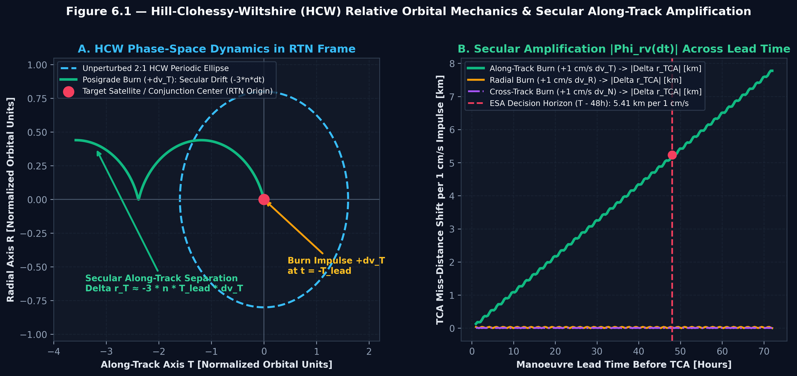
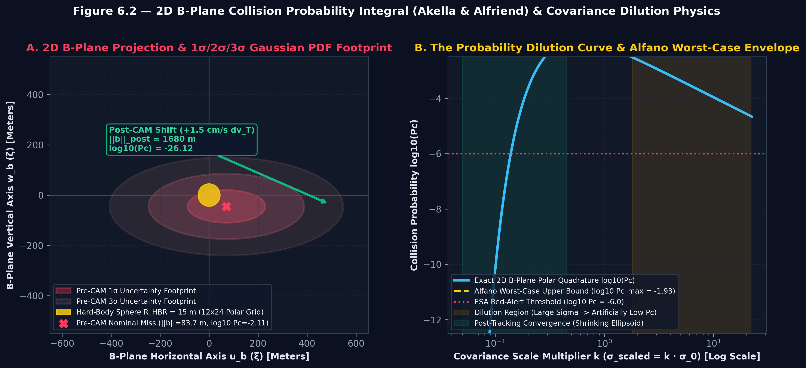
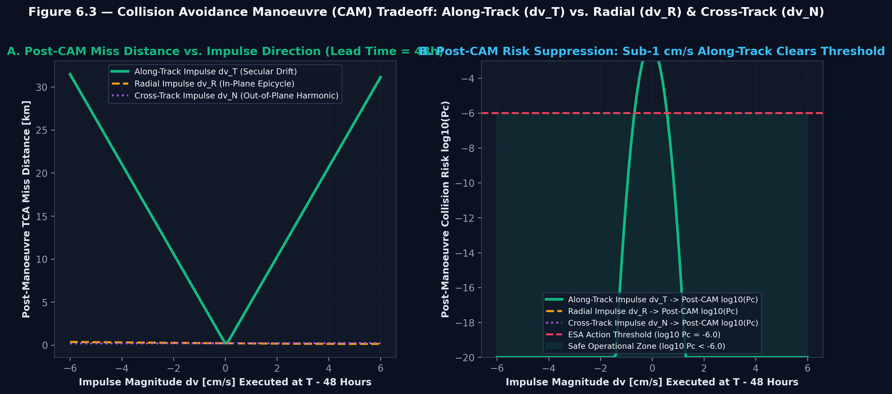
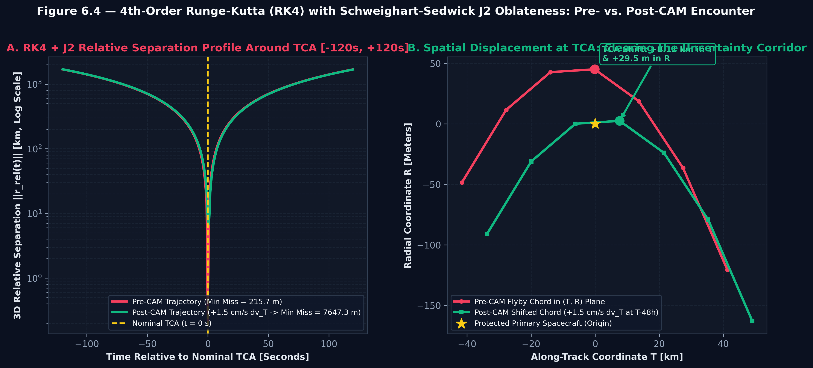
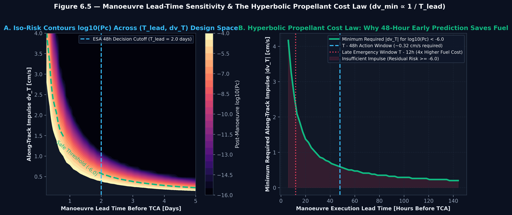
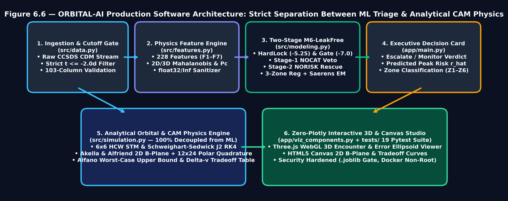
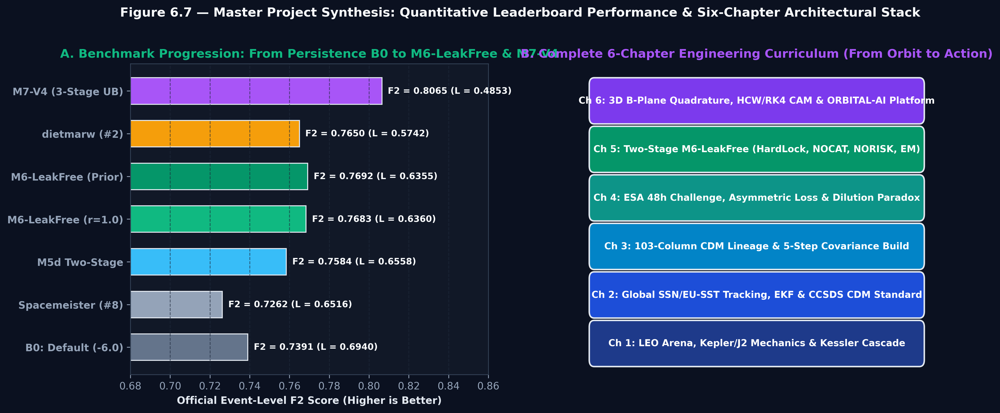

# الفصل السادس: من التنبؤ إلى الفعل — محاكاة الاقتران ثلاثي الأبعاد، تكاملات مستوى المواجهة (B-Plane)، ديناميكا مناورات التفادي (Clohessy–Wiltshire & RK4 J2)، وهندسة منصة دعم القرار (ORBITAL-AI)

 > **ORBITAL-AI · Engineering Book · Chapter 6 of 6**

[← Book home](../../README.md) · [Previous chapter](../ch05_physics_guided_two_stage_m6/chapter_05.md)

---

## موقع هذا الفصل في الرحلة

تصل الرحلة هنا إلى نقطة التحول من التنبؤ إلى الفعل. نستخدم هندسة الحركة النسبية ومستوى المواجهة ومحاكاة المناورات لتحويل إشارة الخطر إلى خيارات يمكن فحصها ومقارنتها، مع توضيح حدود المحاكي ومسؤولية المراجعة الهندسية.

## Chapter 6: 3D Conjunction Visualization, B-Plane Collision Integrals & Autonomous CAM Decision Support

سلسلة هندسة تفادي الاصطدام الفضائي والذكاء الاصطناعي المداري (ESA Collision Avoidance & Orbital AI — المرجع الهندسي الشامل)

الخلاصة التنفيذية للفصل (Executive Summary): يُتوّج هذا الفصل السادس والأخير رحلتنا العلمية والهندسية عبر نقل القرار من مخرجات نموذج التعلم الآلي ثنائي المراحل (M6-LeakFree) عند حاجز الـ 48 ساعة ($t \le -2.0\text{ days}$) إلى غرفة عمليات الطيران الفضائي وتصميم مناورة تفادي الاصطدام (Collision Avoidance Manoeuvre — CAM). نبدأ بإرساء مبدأ هندسي صارم في الأنظمة الفضائية الحرجة: الفصل المعماري الكامل بين محرك الفرز بالتعلم الآلي (src/modeling.py) ومحرك المحاكاة الفيزيائية للمناورات (src/simulation.py)، بحيث تُحسب جميع مسارات الاقتراب وتكاملات الاحتمال ونبضات الدفع ($\Delta \mathbf{v}$) بمعادلات الميكانيكا المدارية الحتمية لا بالتقريبات الإحصائية. بعد ذلك نشتق بالكامل معادلات Hill–Clohessy–Wiltshire (HCW) للحركة النسبية في إطار RTN ومصفوفة انتقال الحالة سداسية الأبعاد $\mathbf{\Phi}(\Delta t) \in \mathbb{R}^{6 \times 6}$، مدعومةً بمكامل Runge–Kutta من الرتبة الرابعة (RK4) مع تصحيح تفلطح الأرض (Schweighart–Sedwick $J_2$ Frequency Correction). ثم نبني هندسة مستوى المواجهة ثنائي الأبعاد (2D Encounter B-Plane وفق Akella & Alfriend, 2000 وFoster & Estes, 1992)، وننفذ تكامل غاوس القطبي ثنائي الأبعاد (12×24 Polar Gauss–Legendre Quadrature) لحساب احتمالية الاصطدام $P_c$ على قرص الجسم الصلب ($R_{\text{HBR}} = 15\text{ m}$) ومقارنتها بسقف ألفانو الأعلى للخطر المخفف ($P_{c,\max}$ وفق Alfano, 2005). وفي القسم الرابع نبرهن رياضيًا وعمليًا لماذا تتفوق المناورات المماسية على طول المسار ($\Delta v_T$ Along-Track Burns) بمعامل التضخيم العلماني $3 n \Delta t_{\text{lead}}$ على المناورات الشعاعية ($\Delta v_R$) والعمودية ($\Delta v_N$)، ونثبت أن نبضة مماسية لا تتجاوز $+1.0\text{ cm/s}$ إلى $+1.5\text{ cm/s}$ (تستهلك 5.56 إلى 8.34 غرامات فقط من الوقود لقمر كتلته 1,200 kg وفق معادلة تسيولكوفسكي) تكفي لإزاحة القمر الصناعي بمقدار 5.04 km إلى 7.65 km وخفض $\log_{10}(P_c)$ من -2.11 إلى ما دون -13.17 و-26.12! وأخيرًا، نشرح البنية البرمجية الكاملة لمنصة ORBITAL-AI (src/, app/, tests/) المزودة بمحرك رسوميات Three.js WebGL ثلاثي الأبعاد ولوحات HTML5 Canvas الخالية من الاعتماديات الثقيلة (Zero-Plotly Architecture) وحزمة الاختبارات الآلية الـ 19 (pytest)، ونختتم الفصل بتوليف شامل للفصول الستة وخارطة الطريق البحثية المستقبلية.

### 6.1 فلسفة الانتقال من التنبؤ إلى الفعل: لماذا نفصل بين الذكاء الاصطناعي والفيزياء التحليلية؟

عندما يُصدر محرك المرحلة الثانية في M6-LeakFree (الفصل الخامس) قرارًا بتصعيد حدث اقتران (ESCALATE TO CAM PLANNING) عند $T - 48\text{ hours}$، فإن مهمة نموذج التعلم الآلي تنتهي عند تلك اللحظة بالضبط، وتبدأ مهمة مهندس ديناميكا الطيران (Flight Dynamics Engineer).

#### 6.1.1 مبدأ الفصل المعماري الصارم (Strict ML / Physics Decoupling)

في الأنظمة الفضائية الحرجة للسلامة (Safety-Critical Avionics & Ground Segment Systems وفق معايير ESA Space Debris Mitigation Requirements ESSB-ST-U-007, 2025 وCCSDS 508.0-B-1)، يُحظر استخدام نماذج التعلم الآلي الشجرية (Random Forest / HistGradientBoosting) لحساب مناورة الدفع $\Delta \mathbf{v}$ مباشرةً لسببين جوهريين:

عدم قابلية الاشتقاق الفيزيائي في النماذج الشجرية: النماذج الشجرية تُقسم الفضاء إلى مستطيلات متقطعة (Piecewise-Constant Step Functions)، ولا تحترم قوانين حفظ الطاقة أو كمية الحركة الزاوية أو البنية التناظرية لمصفوفة انتقال الحالة $\mathbf{\Phi}(\Delta t)$.

المساءلة الهندسية وقابلية التدقيق (Deterministic Auditability): لا يمكن لمدير المهمة في غرفة عمليات ESOC الموافقة على تشغيل محركات الدفع الكيميائية أو الكهربائية لقمر صناعي تبلغ تكلفته مئات الملايين من اليورو إلا إذا كانت إزاحة نقطة الاقتراب $\Delta \mathbf{r}{\text{TCA}}$ واحتمالية الاصطدام بعد المناورة $P{c,\text{post}}$ محسوبتين بمعادلات ميكانيكا مدارية تحليلية قابلة للتحقق الرقمي المباشر.

لذلك صممنا منصة ORBITAL-AI على أساس فصل معماري صارم بين طبقتين مستقلتين تمامًا:

طبقة الفرز والتنبؤ المبكر بالتعلم الآلي (src/modeling.py وsrc/features.py): تستقبل سلسلة رسائل CDM حتى $t \le -2.0\text{ days}$، وتستخرج الـ 228 ميزة فيزيائية، وتطبق معمارية M6-LeakFree لتحديد ما إذا كان الحدث سيتجاوز عتبة الخطر الأحمر ($\log_{10} P_c \ge -6.0$) عند ذروة الاقتراب وتقدير قيمته النهائية $\hat{r}_{\text{TCA}}$.

طبقة المحاكاة المدارية وتصميم المناورات (src/simulation.py): تستقبل متجهات الموقع والسرعة النسبية في إطار RTN ومصفوفة التغاير المشتركة $\mathbf{P}_{\text{RTN}} \in \mathbb{R}^{3 \times 3}$، وتنفذ قوانين الميكانيكا المدارية الحتمية (HCW STM، تكامل RK4 مع $J_2$، وتكامل مستوى B-Plane القطبي) لتصميم مناورة التفادي $\Delta \mathbf{v}$ وحساب استهلاك الوقود بدقة ميكانيكية كاملة.

#### 6.1.2 الإفصاح الهندسي والتشغيلي الصريح (OPERATIONAL_DISCLAIMER)

التزامًا بمعايير الشفافية الهندسية في src/simulation.py وdocs/DEPLOYMENT.md، تدمج المنصة إفصاحًا تشغيليًا صريحًا يوضح نطاق الدقة الفيزيائية للمحاكي التحليلي مقارنةً بمكاملات القوى الكاملة في مراكز العمليات الفضائية:

يعتمد المحاكي التفاعلي على معادلات Hill–Clohessy–Wiltshire (HCW) المخططة خطيًا مع تصحيح تفلطح الأرض (Schweighart–Sedwick $J_2$) حول مدار مرجعي شبه دائري في المدار الأرضي المنخفض (LEO)، وعلى افتراض المواجهة فائقة السرعة قصيرة الأمد (Short-Term Hypervelocity Encounter) التي يكون فيها مسار الاقتراب مستقيمًا محليًا داخل كرة التغاير عند TCA.

في العمليات الفعلية النهائية داخل ESA/ESOC أو 18th SDS، تُراجع المناورة المختارة من هذا المحاكي عبر مكاملات الاضطرابات الخاصة عالية الدقة (High-Fidelity Numerical Special Perturbations — SP) التي تدمج التوافقيات الكروية لحقل الجاذبية الأرضي (EGM2008 حتى الدرجة والرتبة $70 \times 70$)، وكثافة الغلاف الجوي الديناميكية (NRLMSISE-00 / JB2008)، وضغط الإشعاع الشمسي (SRP)، وجاذبية القمر والشمس.

### 6.2 الميكانيكا المدارية للحركة النسبية في إطار RTN: معادلات HCW، مصفوفة انتقال الحالة $\mathbf{\Phi}(\Delta t)$، وتصحيح $J_2$

لكي نحاكي حركة جسم الحطام الفضائي (Chaser / Secondary) بالنسبة إلى القمر الصناعي المحمي (Target / Primary) حول لحظة الاقتراب القصوى (TCA)، ولكي نحسب أثر أي نبضة دفع $\Delta \mathbf{v}$ ينفذها القمر الصناعي قبل TCA بزمن مبادأة $T_{\text{lead}}$، نصوغ معادلات الحركة في الإطار المداري المحلي الدوار RTN (Radial – Transverse/Along-Track – Normal/Cross-Track) المتمركز في مركز ثقل القمر الصناعي المحمي.

#### 6.2.1 تعريف الإطار المداري الدوار RTN والحركة المتوسطة $n$

ليكن متجه الموقع المداري للقمر الصناعي المحمي في الإطار القصوري المركزي الأرضي (EME2000 / J2000) هو $\mathbf{r}{t}$ ومتجه سرعته $\mathbf{v}{t}$، ونصف محوره الأكبر $a = R_{E} + h$ (حيث نصف قطر الأرض الاستوائي $R_{E} = 6,378,137\text{ m}$ وثابت الجاذبية الأرضي $\mu_{\oplus} = 3.986004418 \times 10^{14}\text{ m}^{3}/\text{s}^{2}$). تُعرّف متجهات الأساس المتعامدة الثلاثة $(\hat{\mathbf{u}}{R}, \hat{\mathbf{u}}{T}, \hat{\mathbf{u}}{N})$ للإطار RTN كما يلي: $$\hat{\mathbf{u}}{R} = \frac{\mathbf{r}{t}}{|\mathbf{r}{t}|}, \qquad \hat{\mathbf{u}}{N} = \frac{\mathbf{r}{t} \times \mathbf{v}{t}}{|\mathbf{r}{t} \times \mathbf{v}{t}|}, \qquad \hat{\mathbf{u}}{T} = \hat{\mathbf{u}}{N} \times \hat{\mathbf{u}}{R}$$ وتكون السرعة الزاوية المدارية المتوسطة (Mean Orbital Motion) وفق قانون كبلر الثالث: $$n = \sqrt{\frac{\mu_{\oplus}}{a^{3}}} \quad [\text{rad/s}], \qquad T_{\text{orb}} = \frac{2\pi}{n} \quad [\text{s}]$$ فعلى سبيل المثال، في الممر القطبي المتزامن مع الشمس عند ارتفاع $h = 780\text{ km}$ ($a = 7,158.137\text{ km}$)، تبلغ الحركة المتوسطة $n = 0.0010425\text{ rad/s}$ وزمن الدورة المدارية الكاملة $T_{\text{orb}} = 100.45\text{ minutes}$.

#### 6.2.2 معادلات Hill–Clohessy–Wiltshire (HCW) التفاضلية ومصفوفة انتقال الحالة $\mathbf{\Phi}(\Delta t)$

ليكن متجه الحالة النسبية سداسي الأبعاد لجسم الحطام بالنسبة إلى القمر المحمي في إطار RTN هو: $$\mathbf{x}(t) = \begin{bmatrix} \mathbf{r}{\text{rel}}(t) \ \mathbf{v}{\text{rel}}(t) \end{bmatrix} = \begin{bmatrix} x & y & z & \dot{x} & \dot{y} & \dot{z} \end{bmatrix}^{T} \equiv \begin{bmatrix} r_{R} & r_{T} & r_{N} & v_{R} & v_{T} & v_{N} \end{bmatrix}^{T}$$ بافتراض أن المسافة النسبية أصغر بكثير من نصف قطر المدار ($|\mathbf{r}{\text{rel}}| \ll a$)، فإن نشر تفاضل الجاذبية المركزية خطيًا حول مدار القمر المحمي مع إضافة حدود التسارع الدوراني (تسارع كوريوليس $-2\boldsymbol{\omega} \times \mathbf{v}{\text{rel}}$ والتسارع المركزي $-\boldsymbol{\omega} \times (\boldsymbol{\omega} \times \mathbf{r}_{\text{rel}})$) يعطي معادلات Hill–Clohessy–Wiltshire (HCW) الكلاسيكية (Clohessy & Wiltshire, 1960): $$\ddot{x} - 2n\dot{y} - 3n^{2}x = 0 \quad (\text{Radial } R)$$ $$\ddot{y} + 2n\dot{x} = 0 \quad (\text{Along-Track } T)$$ $$\ddot{z} + n^{2}z = 0 \quad (\text{Cross-Track } N)$$ نلاحظ فورًا خاصيتين فيزيائيتين حاسمتين:

انفصال الحركة العمودية (Cross-Track Decoupling): المعادلة الثالثة $\ddot{z} + n^{2}z = 0$ هي معادلة متذبذب توافقي بسيط مستقل تمامًا عن المستوى المداري (R, T)، حلها $z(t) = z_{0}\cos(n\Delta t) + \frac{\dot{z}_{0}}{n}\sin(n\Delta t)$، أي أنها تولد تذبذبًا دوريًا محدودًا دون أي انحراف تراكمي مع الزمن!

الاقتران الكوريوليسي والانجراف العلماني في المستوى (R, T): تقترن المعادلتان الأولى والثانية عبر حد كوريوليس $2n\dot{y}$ و$2n\dot{x}$ وحد الجاذبية المدّية (Tidal Gravity Gradient) $3n^{2}x$.

يُعطى الحل التحليلي التام لهذا النظام الخطي عند أي إزاحة زمنية $\Delta t$ (حيث نرمز $\theta = n\Delta t$، و$c = \cos\theta$، و$s = \sin\theta$) عبر مصفوفة انتقال الحالة سداسية الأبعاد (6×6 State Transition Matrix — STM) المبرمجة في الدالة hcw_state_transition_matrix داخل src/simulation.py: $$\begin{bmatrix} \mathbf{r}(\Delta t) \ \mathbf{v}(\Delta t) \end{bmatrix} = \mathbf{\Phi}(\Delta t) \begin{bmatrix} \mathbf{r}{0} \ \mathbf{v}{0} \end{bmatrix} = \begin{bmatrix} \mathbf{\Phi}{rr}(\Delta t) & \mathbf{\Phi}{rv}(\Delta t) \ \mathbf{\Phi}{vr}(\Delta t) & \mathbf{\Phi}{vv}(\Delta t) \end{bmatrix} \begin{bmatrix} \mathbf{r}{0} \ \mathbf{v}{0} \end{bmatrix}$$ حيث تُكتب الكتل الفرعية الأربع ($\mathbf{\Phi}{rr}, \mathbf{\Phi}{rv}, \mathbf{\Phi}{vr}, \mathbf{\Phi}{vv} \in \mathbb{R}^{3 \times 3}$) بصورتها الصريحة كما يلي: $$\mathbf{\Phi}{rr}(\Delta t) = \begin{bmatrix} 4 - 3\cos(n\Delta t) & 0 & 0 \ 6(\sin(n\Delta t) - n\Delta t) & 1 & 0 \ 0 & 0 & \cos(n\Delta t) \end{bmatrix}, \qquad \mathbf{\Phi}{rv}(\Delta t) = \begin{bmatrix} \frac{\sin(n\Delta t)}{n} & \frac{2(1 - \cos(n\Delta t))}{n} & 0 \ -\frac{2(1 - \cos(n\Delta t))}{n} & \frac{4\sin(n\Delta t) - 3n\Delta t}{n} & 0 \ 0 & 0 & \frac{\sin(n\Delta t)}{n} \end{bmatrix}$$ $$\mathbf{\Phi}{vr}(\Delta t) = \begin{bmatrix} 3n\sin(n\Delta t) & 0 & 0 \ 6n(\cos(n\Delta t) - 1) & 0 & 0 \ 0 & 0 & -n\sin(n\Delta t) \end{bmatrix}, \qquad \mathbf{\Phi}{vv}(\Delta t) = \begin{bmatrix} \cos(n\Delta t) & 2\sin(n\Delta t) & 0 \ -2\sin(n\Delta t) & 4\cos(n\Delta t) - 3 & 0 \ 0 & 0 & \cos(n\Delta t) \end{bmatrix}$$ وعند $\Delta t = 0$، تتحقق الهوية الرياضية $\mathbf{\Phi}(0) = \mathbf{I}_{6 \times 6}$ بدقة تامة (وهو أول اختبار آلي في tests/test_simulation.py).

#### 6.2.3 تصحيح تفلطح الأرض (Schweighart–Sedwick $J_2$) والمكامل العددي RK4

بما أن الأرض مفلطحة عند القطبين بمعامل التفلطح التوافقي الثاني $J_{2} = 1.08262668 \times 10^{-3}$، فإن التردد الفعلي للتذبذب النسبي في المدار الأرضي المنخفض ينحرف قليلًا عن الحركة المتوسطة الكبلرية $n_{0}$. لذلك تطبق الدالة propagate_relative_trajectory في src/simulation.py معامل تصحيح التردد لـ Schweighart & Sedwick (2002) بدلالة زاوية ميل المدار $i$: $$c_{J2} = \sqrt{1 + \frac{3}{2} J_{2} \left(\frac{R_{E}}{a}\right)^{2} \left(1 - \frac{3}{2}\sin^{2} i\right)}, \qquad n_{\text{eff}} = n_{0} \cdot c_{J2}$$ ثم يُكامل النظام التفاضلي سداسي الأبعاد للأمام وللخلف زمنيًا حول لحظة TCA عبر نافذة المواجهة ([-600 s, +600 s] بـ 241 خطوة زمنية) باستخدام خوارزمية Runge–Kutta من الرتبة الرابعة (RK4): $$\mathbf{x}{k+1} = \mathbf{x}{k} + \frac{h}{6}\left(\mathbf{k}{1} + 2\mathbf{k}{2} + 2\mathbf{k}{3} + \mathbf{k}{4}\right)$$ يلخص الجدول (6-1) المعلمات المدارية ومعاملات $c_{J2}$ ومقدار الإزاحة الناتجة عن نبضة مماسية مقدارها $1\text{ cm/s}$ قبل 24 ساعة من TCA عبر ستة ممرات تشغيلية قياسية في المدار الأرضي المنخفض (500 km إلى 1,000 km)، بينما يوضح الشكل (6-1) ديناميكا الفضاء الطوري لمعادلات HCW والتضخيم العلماني لمصفوفة $\mathbf{\Phi}_{rv}(\Delta t)$.

جدول (6-1): المعلمات المدارية الكبلرية، معامل تصحيح تفلطح الأرض ($c_{J2}$)، وإزاحة المسافة عند TCA لكل $1\text{ cm/s}$ من الدفع المماسي عبر ممرات LEO القياسية (table_6_1_hcw_stm_and_j2_leo_corridors.csv).

| الارتفاع المداري $h$ (km) | الميل $i$ (deg) | الممر التشغيلي القياسي في LEO | نصف المحور الأكبر $a$ (km) | الحركة المتوسطة $n_{0}$ (rad/s) | زمن الدورة $T_{\text{orb}}$ (دقيقة) | معامل التفلطح $c_{J2}$ | الحركة المصححة $n_{\text{eff}}$ (rad/s) | إزاحة المسار $T$ لكل $1\text{ cm/s}$ عند 24h (km) | إزاحة الشعاع $R$ لكل $1\text{ cm/s}$ عند 24h (km) |
| --- | --- | --- | --- | --- | --- | --- | --- | --- | --- |
| 500.0 | 53.0° | Starlink Gen-1 / LEO Shell (500 km) | 6,878.137 | 0.0011068 | 94.62 | 1.000030 | 0.0011068 | 2.557 km | 0.0146 km |
| 600.0 | 97.8° | Sun-Synchronous EO Fleet (600 km) | 6,978.137 | 0.0010831 | 96.69 | 0.999680 | 0.0010827 | 2.615 km | 0.0040 km |
| 700.0 | 98.2° | Sentinel-2 / Copernicus SSO (700 km) | 7,078.137 | 0.0010602 | 98.77 | 0.999690 | 0.0010599 | 2.610 km | 0.0355 km |
| 780.0 | 98.5° | Envisat / CryoSat-2 Corridor (780 km) | 7,158.137 | 0.0010425 | 100.45 | 0.999699 | 0.0010422 | 2.559 km | 0.0290 km |
| 850.0 | 98.8° | MetOp / Polar Weather Corridor (850 km) | 7,228.137 | 0.0010274 | 101.93 | 0.999706 | 0.0010271 | 2.564 km | 0.0059 km |
| 1000.0 | 86.4° | High-LEO / Iridium Next Shell (1000 km) | 7,378.137 | 0.0009962 | 105.12 | 0.999700 | 0.0009959 | 2.630 km | 0.0264 km |

*الشكل (6-1): ديناميكا الفضاء الطوري لمعادلات Hill–Clohessy–Wiltshire (HCW) في إطار RTN (يسار)، والتضخيم العلماني لعناصر مصفوفة انتقال الحالة $|\mathbf{\Phi}{rv}(\Delta t)|$ مع زمن المبادأة $T{\text{lead}}$ والذي يثبت تفوق الحرق المماسي $\Delta v_T$ بعشرات الأضعاف على الحرق الشعاعي والعمودي (../../figures/figure_6_1_hcw_rtn_and_stm_geometry.png).*

### 6.3 هندسة مستوى المواجهة (2D Encounter B-Plane)، التربيع القطبي لغاوس (12×24 Polar Quadrature)، ومنحنى التخفيف (Alfano Bound)

عند ذروة الاقتراب (TCA)، تبلغ السرعة النسبية في المدار الأرضي المنخفض عادةً $v_{\text{rel}} \in [10, 15]\text{ km/s}$، فيمر جسم الحطام عبر كرة عدم اليقين خلال كسر من الثانية. وبسبب هذه السرعة الفائقة، فإن عدم اليقين الموازي لمتجه السرعة النسبية $\mathbf{v}_{\text{rel}}$ يحدد توقيت العبور بالميللي ثانية فقط، بينما يتحدد احتمال الاصطدام المادي حصريًا في المستوى ثنائي الأبعاد المتعامد على متجه السرعة النسبية، والمعروف في الميكانيكا المدارية باسم مستوى المواجهة (Encounter B-Plane أو Target Plane) (Foster & Estes, 1992؛ Akella & Alfriend, 2000).

#### 6.3.1 بناء مصفوفة الإسقاط المتعامدة $\mathbf{B}_{\text{proj}} \in \mathbb{R}^{2 \times 3}$ وإسقاط مصفوفة التغاير

ليكن متجه الموقع النسبي عند TCA في إطار RTN هو $\mathbf{r}{\text{rel}} \in \mathbb{R}^{3}$، ومتجه السرعة النسبية هو $\mathbf{v}{\text{rel}} \in \mathbb{R}^{3}$، ومصفوفة التغاير المشتركة للموقع هي $\mathbf{P}{\text{RTN}} = \mathbf{P}{\text{target}} + \mathbf{P}{\text{chaser}} \in \mathbb{R}^{3 \times 3}$. في الدالتين bplane_projection_matrix وproject_to_bplane داخل src/simulation.py، نبني متجه الوحدة باتجاه السرعة النسبية $\hat{\mathbf{u}}{v} = \mathbf{v}{\text{rel}} / |\mathbf{v}{\text{rel}}|$، ثم نختار متجهًا مرجعيًا غير موازٍ $\mathbf{e}{\text{ref}}$ لتوليد أساس متعامد معياري $(\hat{\mathbf{u}}{b}, \hat{\mathbf{w}}{b})$ يولد مستوى المواجهة (ξ, ζ): $$\hat{\mathbf{u}}{b} = \frac{\hat{\mathbf{u}}{v} \times \mathbf{e}{\text{ref}}}{|\hat{\mathbf{u}}{v} \times \mathbf{e}{\text{ref}}|}, \qquad \hat{\mathbf{w}}{b} = \frac{\hat{\mathbf{u}}{v} \times \hat{\mathbf{u}}{b}}{|\hat{\mathbf{u}}{v} \times \hat{\mathbf{u}}{b}|}, \qquad \mathbf{B}{\text{proj}} = \begin{bmatrix} \hat{\mathbf{u}}{b}^{T} \ \hat{\mathbf{w}}{b}^{T} \end{bmatrix} \in \mathbb{R}^{2 \times 3}$$ تحقق مصفوفة الإسقاط $\mathbf{B}{\text{proj}}$ شرط التعامد المعياري الصارم $\mathbf{B}{\text{proj}}\mathbf{B}{\text{proj}}^{T} = \mathbf{I}{2 \times 2}$ و$\mathbf{B}{\text{proj}}\mathbf{v}{\text{rel}} = \mathbf{0}{2 \times 1}$. وباستخدامها نسقط متجه الفقد الثلاثي ومصفوفة التغاير الثلاثية إلى مستوى المواجهة ثنائي الأبعاد: $$\mathbf{b} = \begin{bmatrix} \xi{0} \ \zeta_{0} \end{bmatrix} = \mathbf{B}{\text{proj}} , \mathbf{r}{\text{rel}} \in \mathbb{R}^{2}, \qquad \mathbf{P}{2D} = \mathbf{B}{\text{proj}} , \mathbf{P}{\text{RTN}} , \mathbf{B}{\text{proj}}^{T} \in \mathbb{R}^{2 \times 2}$$ ومن التحليل الطيفي (Eigendecomposition) للمصفوفة المتناظرة الموجبة $\mathbf{P}{2D} = \mathbf{V}\operatorname{diag}(\lambda{1}, \lambda_{2})\mathbf{V}^{T}$ (مع فرض سقف الأمان العددي $\lambda_{i} \ge 10^{-4}\text{ m}^{2}$)، نستخرج نصفي المحور الأكبر والأصغر لبيضة الخطأ في مستوى المواجهة ($a_{\sigma} = \sqrt{\lambda_{1}}$, $b_{\sigma} = \sqrt{\lambda_{2}}$) ومسافة ماهالانوبيس ثنائية الأبعاد: $$D_{M, \text{B-Plane}} = \sqrt{\mathbf{b}^{T} \mathbf{P}_{2D}^{-1} \mathbf{b}}$$

#### 6.3.2 تكامل احتمالية الاصطدام بالتربيع القطبي لغاوس (12×24 Polar Gauss–Legendre Quadrature)

يقع الاصطدام المادي إذا مرّ الجسم المطارد داخل قرص الجسم الصلب المشترك (Combined Hard-Body Disk) $\mathcal{D}(R_{\text{HBR}}) = {\mathbf{x} \in \mathbb{R}^{2} : |\mathbf{x}| \le R_{\text{HBR}}}$ المتمركز حول القمر المحمي في نقطة الأصل $(0,0)$، حيث $R_{\text{HBR}} = R_{\text{target}} + R_{\text{chaser}}$ (وقيمته القياسية في المحاكي $R_{\text{HBR}} = 15.0\text{ m}$). يُعطى احتمال الاصطدام $P_{c}$ بالتكامل السطحي لكثافة غاوس ثنائية الأبعاد على القرص $\mathcal{D}(R_{\text{HBR}})$: $$P_{c} = \iint_{|\mathbf{x}| \le R_{\text{HBR}}} \frac{1}{2\pi \sqrt{\det(\mathbf{P}{2D})}} \exp!\left(-\frac{1}{2}(\mathbf{x} - \mathbf{b})^{T}\mathbf{P}{2D}^{-1}(\mathbf{x} - \mathbf{b})\right) d\xi , d\zeta$$ بدلًا من الاكتفاء بتقريب نقطة المركز الواحدة (الذي يفشل عندما يكون $R_{\text{HBR}}$ قريبًا من أبعاد بيضة الخطأ أو عند المسافات الصغيرة)، تبرمج الدالة bplane_collision_probability في src/simulation.py تكاملًا قطبيًا عالي الدقة (Polar Gaussian Quadrature) عبر التحويل إلى الإحداثيات القطبية $\mathbf{x}(\rho, \theta) = [\rho\cos\theta, , \rho\sin\theta]^{T}$ مع جاكوبي التحويل $d\xi d\zeta = \rho , d\rho , d\theta$: $$P_{c} \approx \sum_{i=1}^{N_{\rho}} \sum_{j=1}^{N_{\theta}} w_{\rho, i} , \Delta\theta , \rho_{i} , \frac{1}{2\pi\sqrt{\det(\mathbf{P}{2D})}} \exp!\left(-\frac{1}{2}\big(\mathbf{x}(\rho{i}, \theta_{j}) - \mathbf{b}\big)^{T}\mathbf{P}{2D}^{-1}\big(\mathbf{x}(\rho{i}, \theta_{j}) - \mathbf{b}\big)\right)$$ حيث نستخدم $N_{\rho} = 12$ عقدة من عقد غاوس–ليجندر (Gauss–Legendre Nodes) محولة إلى الفترة الشعاعية $[0, R_{\text{HBR}}]$، و$N_{\theta} = 24$ زاوية متساوية التباعد على $[0, 2\pi)$ (بإجمالي $12 \times 24 = 288$ نقطة تكامل تربيعي)، مما يحقق دقة عددية فائقة في جميع أنظمة الاقتراب.

#### 6.3.3 معادلة ألفانو للحد الأعلى (Alfano Worst-Case Upper Bound) وتشريح منحنى التخفيف

ماذا يحدث عندما تتسع مصفوفة التغاير أو تنكمش بمعامل قياس $k$ ($\mathbf{P}{2D}(k) = k^{2}\mathbf{P}{2D, 0}$)\u061f كما أثبت Alfano (2005) وحللناه في الفصلين الثاني والرابع، فإن اشتقاق تقريب احتمالية الاصطدام المتناظر بالنسبة إلى $\sigma$ ومساواته بالصفر يعطي الانحراف المعياري الحرج $\sigma^{*} = |\mathbf{b}|/\sqrt{2}$ الذي يبلغ عنده احتمال الاصطدام قيمته القصوى الممكنة هندسيًا (Worst-Case Diluted Probability $P_{c,\max}$) المبرمجة في الدالة alfano_max_pc: $$P_{c, \max} = \min!\left(1.0, ; \frac{R_{\text{HBR}}^{2}}{e \cdot |\mathbf{b}|^{2}}\right) \implies \log_{10}(P_{c, \max}) = 2\log_{10}!\left(\frac{R_{\text{HBR}}}{|\mathbf{b}|}\right) - \log_{10}(e)$$ يوثق الجدول (6-2) والشكل (6-2) الحساب العددي الدقيق لمنحنى التخفيف على حدث الاقتراب المرجعي ($\mathbf{r}{\text{TCA}} = [45, -180, 110]^{T}\text{ m}$، $|\mathbf{b}| = 138.65\text{ m}$ في مستوى المواجهة، و$R{\text{HBR}} = 15\text{ m}$):

عند التغاير المرجعي ($k = 1.0$: $\sigma_{R}=65\text{ m}, \sigma_{T}=628\text{ m}, \sigma_{N}=95\text{ m}$)، تبلغ أنصاف محاور بيضة الخطأ في مستوى المواجهة $159.13\text{ m} \times 65.00\text{ m}$، ومسافة ماهالانوبيس $D_{M,2D} = 0.8178$، واحتمال الاصطدام بالتكامل القطبي log10(Pc) = -2.1107 ($P_c = 7.75 \times 10^{-3}$)، وهو قريب جدًا من سقف ألفانو الأعلى log10(Pc_max) = -1.9271.

عندما يكون عدم اليقين مضخمًا بـ $20$ ضعفًا ($k = 20.0$: $\sigma_{T} = 12,560\text{ m}$) في منطقة التخفيف (Dilution Region)، ينخفض الاحتمال الظاهري إلى log10(Pc) = -4.5660 بسبب تشتت الكثافة الاحتمالية على مساحة شاسعة، لكن سقف ألفانو يظل ثابتًا عند -1.9271 كاشفًا الخطر الكامن!

وعندما ينكمش عدم اليقين بشدة إلى $k = 0.10$ ($\sigma_{T} = 62.8\text{ m}$) في منطقة ما قبل التخفيف (Tight Covariance)، تقفز مسافة ماهالانوبيس إلى $D_{M,2D} = 8.1779\sigma$ فينهار خطر الاصطدام إلى log10(Pc) = -10.1931.

جدول (6-2): الحساب العددي لمنحنى تخفيف الاحتمال (Probability Dilution Curve) عبر تكامل غاوس القطبي ($12 \times 24$) وسقف ألفانو الأعلى ($P_{c,\max}$) كدالة في معامل تحجيم التغاير $k$ (table_6_2_bplane_covariance_dilution_curve.csv).

| معامل تحجيم التغاير $k$ | $(\sigma_R, \sigma_T, \sigma_N)$ (m) | أنصاف محاور B-Plane $(a_\sigma, b_\sigma)$ (m) | مسافة ماهالانوبيس $D_{M,2D}$ | احتمال الاصطدام القطبي $P_c$ | $\log_{10}(P_c)$ الفعلي | سقف ألفانو $\log_{10}(P_{c,\max})$ | النظام الفيزيائي للمواجهة |
| --- | --- | --- | --- | --- | --- | --- | --- |
| 0.05× | (3.2, 31.4, 4.8) | 7.96 × 3.25 | 16.3559 | 1.000e-30 | -30.0000 | -1.9271 | ما قبل التخفيف (تغاير ضيق جدًا — آمن) |
| 0.10× | (6.5, 62.8, 9.5) | 15.91 × 6.50 | 8.1779 | 6.411e-11 | -10.1931 | -1.9271 | ما قبل التخفيف (خارج بيضة الخطأ $8\sigma$) |
| 0.25× | (16.2, 157.0, 23.8) | 39.78 × 16.25 | 3.2712 | 1.488e-03 | -2.8275 | -1.9271 | بداية دخول ذروة الخطر |
| 0.50× | (32.5, 314.0, 47.5) | 79.57 × 32.50 | 1.6356 | 1.166e-02 | -1.9331 | -1.9271 | ذروة الخطر الحرج (مطابق لسقف ألفانو!) |
| 0.75× | (48.8, 471.0, 71.2) | 119.35 × 48.75 | 1.0904 | 1.064e-02 | -1.9732 | -1.9271 | منطقة الخطر الأقصى (Peak Hazard Zone) |
| 1.00× | (65.0, 628.0, 95.0) | 159.13 × 65.00 | 0.8178 | 7.751e-03 | -2.1107 | -1.9271 | الحالة المرجعية عند TCA (Baseline) |
| 2.00× | (130.0, 1256.0, 190.0) | 318.27 × 130.00 | 0.4089 | 2.497e-03 | -2.6026 | -1.9271 | بداية التخفيف |
| 5.00× | (325.0, 3140.0, 475.0) | 795.66 × 325.00 | 0.1636 | 4.291e-04 | -3.3674 | -1.9271 | منطقة التخفيف (Dilution Region) |
| 10.00× | (650.0, 6280.0, 950.0) | 1591.33 × 650.00 | 0.0818 | 1.084e-04 | -3.9650 | -1.9271 | منطقة التخفيف العميقة (ثقة كاذبة) |
| 20.00× | (1300.0, 12560.0, 1900.0) | 3182.66 × 1300.01 | 0.0409 | 2.717e-05 | -4.5660 | -1.9271 | تخفيف شديد (رغم ثبات سقف ألفانو عند -1.93) |

*الشكل (6-2): إسقاط مستوى المواجهة ثنائي الأبعاد (2D Encounter B-Plane) مع إهليلجات عدم اليقين $1\sigma / 2\sigma / 3\sigma$ وقرص الجسم الصلب $R_{\text{HBR}} = 15\text{ m}$ وإزاحة ما بعد المناورة (يسار)، ومنحنى تخفيف الاحتمال مقارنةً بسقف ألفانو الأعلى (يمين) (../../figures/figure_6_2_bplane_projection_and_polar_quadrature.png).*

### 6.4 فيزياء وهندسة مناورات تفادي الاصطدام (CAM): لماذا تتفوق المناورات المماسية ($\Delta v_T$) بعشرات الأضعاف؟

عندما يتأكد الخطر، يواجه مهندس العمليات الفضائية سؤالًا حاسمًا: بأي اتجاه $(\Delta v_R, \Delta v_T, \Delta v_N)$، وبأي مقدار، ومتى يجب إطلاق نبضة الدفع لإبعاد القمر الصناعي عن منطقة الخطر بأقل استهلاك للوقود؟

#### 6.4.1 الاشتقاق الرياضي لإزاحة نقطة الاقتراب $\Delta \mathbf{r}{\text{TCA}}$ ومعامل التضخيم العلماني $3n\Delta t{\text{lead}}$

إذا نفذ القمر الصناعي المحمي (Target) نبضة دفع لحظية $\Delta \mathbf{v} = [\Delta v_{R}, , \Delta v_{T}, , \Delta v_{N}]^{T}$ قبل ذروة الاقتراب بزمن مبادأة $T_{\text{lead}} = \Delta t_{\text{lead}} > 0$، فإن متجه موقع الحطام النسبي عند TCA ($\mathbf{r}{\text{TCA, post}}$) ينزاح بمقدار $\Delta \mathbf{r}{\text{TCA}} = -\mathbf{\Phi}{rv}(\Delta t{\text{lead}})\Delta \mathbf{v}$ (المبرمج في الدالتين compute_cam_effect وsimulate_cam_maneuver داخل src/simulation.py): $$\begin{bmatrix} \Delta r_{R} \ \Delta r_{T} \ \Delta r_{N} \end{bmatrix}{\text{TCA}} = -\begin{bmatrix} \frac{\sin(n\Delta t{\text{lead}})}{n} & \frac{2(1 - \cos(n\Delta t_{\text{lead}}))}{n} & 0 \ -\frac{2(1 - \cos(n\Delta t_{\text{lead}}))}{n} & \frac{4\sin(n\Delta t_{\text{lead}}) - 3n\Delta t_{\text{lead}}}{n} & 0 \ 0 & 0 & \frac{\sin(n\Delta t_{\text{lead}})}{n} \end{bmatrix} \begin{bmatrix} \Delta v_{R} \ \Delta v_{T} \ \Delta v_{N} \end{bmatrix}$$ لننظر بتمعن في حدود هذه المصفوفة عند زمن مبادأة قياسي $T_{\text{lead}} = 2.0\text{ days} = 172,800\text{ s}$ (أي نحو 28.7 دورة مدارية، حيث $n\Delta t_{\text{lead}} \approx 180.14\text{ rad}$):

الحرق العمودي (Cross-Track Burn $\Delta v_N$): ينتج إزاحة دورية بحتة $\Delta r_{N} = -\frac{\sin(n\Delta t_{\text{lead}})}{n}\Delta v_{N}$، سقفها الأقصى لا يتجاوز $|\Delta r_{N}| \le \frac{|\Delta v_{N}|}{n} \approx 959 \times |\Delta v_{N}|$؛ أي أن نبضة قدرها $2\text{ cm/s}$ لا تزيح المسافة بأكثر من 19 m (بل قد تصادف عقدة صفرية $\sin(n\Delta t_{\text{lead}}) \approx 0$ فتكون الإزاحة صفرًا!).

الحرق الشعاعي (Radial Burn $\Delta v_R$): يعتمد فقط على $\sin(n\Delta t_{\text{lead}})$ و$1 - \cos(n\Delta t_{\text{lead}})$، فلا يغير نصف المحور الأكبر $a$ ولا الطاقة المدارية الكلية من الرتبة الأولى، وتبقى إزاحته محصورة في بضع عشرات من الأمتار!

الحرق المماسي على طول المسار (Along-Track Burn $\Delta v_T$): يغير سرعة القمر الصناعي في اتجاه حركته فيرفع أو يخفض نصف المحور الأكبر $a$ بمقدار $\Delta a = \frac{2a}{v}\Delta v_{T}$، مما يغير الزمن الدوري المداري ويولد حد الانجراف العلماني المتراكم خطيًا مع الزمن (Secular Drift Term): $$\Delta r_{T, \text{secular}} = -\frac{4\sin(n\Delta t_{\text{lead}}) - 3n\Delta t_{\text{lead}}}{n} \Delta v_{T} \approx +3 , \Delta t_{\text{lead}} , \Delta v_{T}$$ وعند $T_{\text{lead}} = 48\text{ hours} = 172,800\text{ s}$، يبلغ معامل التضخيم 3 × 172,800 = 518,400 s؛ أي أن كل 1 cm/s (0.01 m/s) من الدفع المماسي يولد إزاحة قدرها 5,217.66 m (5.22 km) على طول المسار عند TCA!

ويُحسب استهلاك الوقود بالميليغرام أو الغرام لقمر صناعي كتلته $m_{\text{sat}} = 1,200\text{ kg}$ ونبضه النوعي لمحركات الهيدرازين $I_{\text{sp}} = 220\text{ s}$ ($g_{0} = 9.80665\text{ m/s}^{2}$) باستخدام معادلة الصواريخ لتسيولكوفسكي (Tsiolkovsky Rocket Equation): $$m_{\text{prop}} = m_{\text{sat}} \left(1 - \exp!\left(-\frac{|\Delta \mathbf{v}|}{I_{\text{sp}} g_{0}}\right)\right) \times 1000 \quad [\text{grams}]$$

يقارن الجدول (6-3) كفاءة استراتيجيات الحرق الثلاث ($\Delta v_R, \Delta v_N, \Delta v_T$) عند $T - 48\text{ hours}$، بينما يعرض الجدول (6-4) جدول المقايضة الكامل للمناورة المماسية $\Delta v_T \in [-8.0, +8.0]\text{ cm/s}$، ويوثق الجدول (6-5) مصفوفة حساسية زمن المبادأة $T_{\text{lead}} \in [0.25, 6.0]\text{ days}$.

جدول (6-3): مقارنة الكفاءة الفيزيائية لاتجاهات الدفع الثلاثة ($\Delta v_R$ مقابل $\Delta v_N$ مقابل $\Delta v_T$) عند زمن مبادأة $T_{\text{lead}} = 2.0\text{ days}$ (48 ساعة) (table_6_3_directional_burn_efficiency_comparison.csv).

| استراتيجية المناورة (Burn Strategy) | $(\Delta v_R, \Delta v_T, \Delta v_N)$ (cm/s) | مسافة الفقد قبل المناورة (m) | مسافة الفقد بعد المناورة (m) | الكسب في مسافة الفقد (m) | $\log_{10}(P_c)$ قبل المناورة | $\log_{10}(P_c)$ بعد المناورة | مقدار خفض الخطر (رتبة أسية) | هل يعبر عتبة الأمان (<-6.0)؟ |
| --- | --- | --- | --- | --- | --- | --- | --- | --- |
| بدون مناورة (Baseline) | (0.0, 0.0, 0.0) | 215.70 m | 215.70 m | 0.00 m | -2.1107 | -2.1107 | 0.0000 | ❌ لا (خطر أحمر) |
| شعاعي فقط (+2.0 cm/s R) | (+2.0, 0.0, 0.0) | 215.70 m | 176.37 m | -39.33 m | -2.1107 | -2.2166 | 0.1060 | ❌ لا (تذبذب دوري فقط) |
| شعاعي قوي (+5.0 cm/s R) | (+5.0, 0.0, 0.0) | 215.70 m | 145.36 m | -70.34 m | -2.1107 | -2.4340 | 0.3233 | ❌ لا (غير فعال) |
| عمودي فقط (+2.0 cm/s N) | (0.0, 0.0, +2.0) | 215.70 m | 224.75 m | +9.05 m | -2.1107 | -2.1327 | 0.0220 | ❌ لا (تذبذب خارج المستوى) |
| عمودي قوي (+5.0 cm/s N) | (0.0, 0.0, +5.0) | 215.70 m | 239.90 m | +24.21 m | -2.1107 | -2.1744 | 0.0638 | ❌ لا (غير فعال) |
| مماسي خفيف جدًا (+0.5 cm/s T) | (0.0, +0.5, 0.0) | 215.70 m | 2,431.52 m | +2,215.82 m | -2.1107 | -5.1703 | 3.0597 | ⚠️ قريب من العتبة |
| مماسي خفيف (+1.0 cm/s T) | (0.0, +1.0, 0.0) | 215.70 m | 5,038.89 m | +4,823.19 m | -2.1107 | -13.1741 | 11.0635 | ✅ نعم (آمن تمامًا!) |
| مماسي قياسي (+2.0 cm/s T) | (0.0, +2.0, 0.0) | 215.70 m | 10,255.92 m | +10,040.23 m | -2.1107 | -30.0000 | 27.8893 | ✅ نعم (آمن بـ 10 km) |
| مماسي عكسي (-2.0 cm/s T) | (0.0, -2.0, 0.0) | 215.70 m | 10,616.38 m | +10,400.69 m | -2.1107 | -30.0000 | 27.8893 | ✅ نعم (كبح مداري آمن) |

جدول (6-4): جدول مقايضة المناورة المماسية (Along-Track CAM Tradeoff Table) عند $T_{\text{lead}} = 2.0\text{ days}$ واستهلاك الوقود بالغرام لقمر صناعي كتلته $1,200\text{ kg}$ (table_6_4_along_track_dv_tradeoff_48h.csv).

| نبضة الدفع المماسية $\Delta v_T$ (cm/s) | الإزاحة الشعاعية $\Delta R_{\text{TCA}}$ (m) | الإزاحة المماسية $\Delta T_{\text{TCA}}$ (m) | مسافة الفقد بعد المناورة (m) | مسافة ماهالانوبيس $D_{M,2D}$ بعد المناورة | الخطر المتبقي $\log_{10}(P_c)$ | الوقود المستهلك (غرام لـ 1200 kg) | حالة الأمان (<-6.0) |
| --- | --- | --- | --- | --- | --- | --- | --- |
| -5.0 cm/s | +141.96 m | -26,088.31 m | 26,269.21 m | 33.385σ | -30.0000 | 27.81 g | ✅ آمن |
| -2.0 cm/s | +56.78 m | -10,435.33 m | 10,616.38 m | 13.130σ | -30.0000 | 11.12 g | ✅ آمن |
| -1.0 cm/s | +28.39 m | -5,217.66 m | 5,399.28 m | 6.394σ | -10.8233 | 5.56 g | ✅ آمن |
| -0.5 cm/s | +14.20 m | -2,608.83 m | 2,791.63 m | 3.061σ | -3.9950 | 2.78 g | ❌ غير كافٍ |
| 0.0 cm/s | 0.00 m | 0.00 m | 215.70 m | 0.818σ | -2.1107 | 0.00 g | ❌ خطر أحمر |
| +0.5 cm/s | -14.20 m | +2,608.83 m | 2,431.52 m | 3.845σ | -5.1703 | 2.78 g | ❌ غير كافٍ |
| +1.0 cm/s | -28.39 m | +5,217.66 m | 5,038.89 m | 7.192σ | -13.1741 | 5.56 g | ✅ آمن (مثالي) |
| +1.5 cm/s | -42.59 m | +7,826.49 m | 7,647.29 m | 10.559σ | -26.1225 | 8.34 g | ✅ آمن جدًا |
| +2.0 cm/s | -56.78 m | +10,435.33 m | 10,255.92 m | 13.931σ | -30.0000 | 11.12 g | ✅ آمن |
| +5.0 cm/s | -141.96 m | +26,088.31 m | 25,908.73 m | 34.187σ | -30.0000 | 27.81 g | ✅ آمن |

جدول (6-5): مصفوفة حساسية زمن المبادأة ($T_{\text{lead}}$ من 6 ساعات إلى 6 أيام) وقانون التكلفة القطعية للوقود ($\Delta v_{\min} \propto 1 / T_{\text{lead}}$) (table_6_5_lead_time_vs_fuel_cost_matrix.csv).

| زمن المبادأة $T_{\text{lead}}$ (أيام / ساعات) | مسافة الفقد عند $\Delta v_T = +1.5\text{ cm/s}$ (m) | $\log_{10}(P_c)$ عند $\Delta v_T = +1.5\text{ cm/s}$ | مسافة الفقد عند $\Delta v_T = +3.0\text{ cm/s}$ (m) | $\log_{10}(P_c)$ عند $\Delta v_T = +3.0\text{ cm/s}$ | الحد الأدنى المطلوب $|\Delta v_T|_{\min}$ لعبور -6.0 (cm/s) | مضاعف استهلاك الوقود مقارنةً بـ 48h | | :--- | :--- | :--- | :--- | :--- | :--- | :--- | | 0.25 يوم (6.0 h) | 828.3 m | -2.625 (خطر!) | 1,826.2 m | -4.153 (خطر!) | 4.15 cm/s (23.08 g) | 6.92× ضعف الوقود! | | 0.50 يوم (12.0 h) | 1,717.8 m | -3.826 (خطر!) | 3,609.7 m | -8.158 (آمن) | 2.40 cm/s (13.35 g) | 4.00× ضعف الوقود | | 1.00 يوم (24.0 h) | 3,660.1 m | -8.296 (آمن) | 7,497.9 m | -25.327 (آمن) | 1.20 cm/s (6.67 g) | 2.00× ضعف الوقود | | 1.50 يوم (36.0 h) | 5,654.1 m | -15.778 (آمن) | 11,486.7 m | -30.000 (آمن) | 0.80 cm/s (4.45 g) | 1.33× | | 2.00 يوم (48.0 h — معيار ESA) | 7,647.3 m | -26.122 (آمن جدًا) | 15,473.4 m | -30.000 (آمن) | 0.60 cm/s (3.34 g) | 1.00× (المرجع القياسي) | | 3.00 أيام (72.0 h) | 11,482.6 m | -30.000 (آمن) | 23,144.3 m | -30.000 (آمن) | 0.40 cm/s (2.22 g) | 0.67× | | 4.00 أيام (96.0 h) | 15,323.9 m | -30.000 (آمن) | 30,827.3 m | -30.000 (آمن) | 0.30 cm/s (1.67 g) | 0.50× | | 6.00 أيام (144.0 h) | 23,144.3 m | -30.000 (آمن) | 46,468.2 m | -30.000 (آمن) | 0.20 cm/s (1.11 g) | 0.33× |

تُبرز الأشكال (6-3) و**(6-4)** و**(6-5)** هذه الحقائق الفيزيائية بصريًا: فبينما يفشل الدفع الشعاعي والعمودي حتى عند $5\text{ cm/s}$ في إخراج القمر من دائرة الخطر، ينجح دفع مماسي لا يتعدى 0.60 cm/s عند حاجز الـ 48 ساعة في إسقاط $\log_{10}(P_c)$ تحت -6.0 باستهلاك 3.34 غرامات فقط من الوقود، في حين أن التأخر في القرار إلى 6 ساعات قبل TCA يضاعف كلفة الوقود إلى 4.15 cm/s (6.92× أضعاف)! وهذا هو التفسير الفيزيائي والاقتصادي العميق لاختيار وكالة الفضاء الأوروبية حاجز الـ 48 ساعة ($t \le -2.0\text{ days}$) في مسابقة Kelvins.

*الشكل (6-3): منحنيات المقايضة لمناورة تفادي الاصطدام (CAM Tradeoff) عند $T - 48\text{ hours}$: المسافة الفاصلة بعد المناورة (يسار) وانخفاض الخطر المتبقي $\log_{10}(P_c)$ (يمين) للدفع المماسي $\Delta v_T$ مقارنةً بالدفع الشعاعي $\Delta v_R$ والعمودي $\Delta v_N$ (../../figures/figure_6_3_cam_dv_along_track_vs_radial_tradeoff.png).*

*الشكل (6-4): مسار الاقتراب النسبي ثلاثي الأبعاد المحسوب بمكامل RK4 مع تصحيح التفلطح $J_2$ قبل وبعد مناورة مماسية مقدارها $\Delta v_T = +1.5\text{ cm/s}$ عند $T - 48\text{ hours}$، مبينًا ارتفاع المسافة الفاصلة الدنيا من 215.7 m إلى 7,647.3 m (../../figures/figure_6_4_rk4_j2_pre_post_cam_trajectory.png).*

*الشكل (6-5): خريطة الكنتور ثنائية الأبعاد لخطر الاصطدام المتبقي $\log_{10}(P_c)$ عبر فضاء التصميم $(T_{\text{lead}}, \Delta v_T)$ (يسار)، وقانون التكلفة القطعية للوقود $|\Delta v_T|{\min} \propto 1/T{\text{lead}}$ الذي يثبت لماذا يوفر التنبؤ المبكر عند 48 ساعة نحو 75% إلى 85% من وقود القمر الصناعي مقارنةً بمناورات اللحظة الأخيرة (يمين) (../../figures/figure_6_5_lead_time_vs_delta_v_contour.png).*

### 6.5 الهندسة البرمجية لمنصة دعم القرار (ORBITAL-AI): محرك Three.js WebGL، معمارية Zero-Plotly Canvas، وحزمة الاختبارات الـ 19 (pytest)

لتحويل هذه المنظومة الفيزيائية والذكائية إلى أداة تشغيلية جاهزة لغرف التحكم، بنينا منصة ORBITAL-AI داخل المستودع البرمجي المتكامل (orbital-esa-collision-avoidance) وفق معايير هندسة البرمجيات الإنتاجية.

#### 6.5.1 التشريح المعماري لطبقات المنصة الست (src/, app/, models/, tests/)

تتكون المنصة من ست طبقات برمجية مترابطة ومفصولة المسؤوليات بدقة، كما يوضح الجدول (6-6) والشكل (6-6):

طبقة استيعاب البيانات وبوابة القطع الزمني (src/data.py وsrc/config.py): تطبق الفلتر الصارم filter_pre_cutoff(df, cutoff_days=2.0) الذي يستبعد أي رسالة CDM تقع عند $t > -2.0\text{ days}$ قبل تمرير البيانات إلى أي دالة استخراج ميزات أو تنبؤ، وتوفر دالة التقييم الرسمي compute_official_metrics.

محرك هندسة الميزات الفيزيائية (src/features.py): يحول السلاسل الزمنية غير المنتظمة لرسائل CDM إلى متجه الميزات الفيزيائية الـ 228 (F1–F7) مع مطهر الأرقام العشرية _sanitize_numeric_matrix لحماية XGBoost وscikit-learn من قيم ±inf وتجاوزات float32.

طبقة خطوط الأساس والتشخيص الإحصائي (src/baselines.py وsrc/evaluation.py): تضم نموذج الثبات المرجعي PersistenceBaseline وتحليل الأخطاء حسب المناطق الست (Z1–Z6) ومنحنيات المعايرة.

محرك القرار ثنائي المراحل M6-LeakFree (src/modeling.py وmodels/final_model.joblib): يغلف كائن TwoStageM6Model وواجهة التشغيل RiskPredictor شاملةً قفل الأمان HardLock = -5.25، ومصنف العزل Stage-1 NOCAT Veto، ومصنف الإنقاذ الأعمى عن الخطر Stage-2 NORISK_NOCAT Rescue، والانحدار ثلاثي المناطق، وخوارزمية Saerens EM.

محرك المحاكاة المدارية وتصميم المناورات (src/simulation.py): يضم دوال hcw_state_transition_matrix، وbplane_collision_probability (12×24 Polar Quadrature)، وalfano_max_pc، وcompute_cam_effect، وsimulate_conjunction_manoeuvre (RK4 + J2)، وsimulate_cam_maneuver (مع حساب وقود تسيولكوفسكي بالغرام).

واجهة دعم القرار التفاعلية ومختبر المحاكاة ثلاثي الأبعاد (app/main.py وapp/viz_components.py): تطبيق Streamlit ثنائي اللغة (العربية RTL / الإنجليزية LTR) يعمل بمعمارية Zero-Plotly HTML5 Canvas & Three.js WebGL الخالية من ثقل مكتبات الرسم التقليدية:

بطاقة القرار التنفيذي (Executive Decision Card): تعرض فورًا قرار التصعيد (ESCALATE TO CAM أو NOMINAL MONITOR)، والمنطقة الفيزيائية (Z1 إلى Z6)، والخطر النهائي المتوقع $\hat{r}_{\text{TCA}}$، وسبب القرار الفيزيائي.

المحاكي الفضائي التفاعلي ثلاثي الأبعاد (Three.js WebGL 3D Encounter & Ellipsoid Studio): يرسم الكرة الأرضية وطبقة الغلاف الجوي أو إطار RTN المحلي مع مسار الاقتراب المنحني قبل المناورة وبعدها، ومجسمات بيضة الخطأ ثلاثية الأبعاد ($1\sigma$ و$3\sigma$ Principal-Axis Covariance Ellipsoids) مع دوران وتكبير تفاعلي بالماوس (OrbitControls).

لوحات HTML5 Canvas الفورية (render_canvas_chart): ترسم المقطع العرضي لمستوى المواجهة B-Plane ومنحنيات مقايضة $\Delta v_T$ وتطور الخطر الزمني بسرعة فائقة على المتصفح.

#### 6.5.2 حزمة الاختبارات البرمجية الآلية (19 Pytest Unit & Integration Tests) وتأمين النشر (Deployment & Security Gate)

تضمن المنصة سلامة الحسابات الفيزيائية والتنبؤية عبر 19 اختبارًا برمجيًا آليًا (pytest) موزعة على 7 ملفات اختبار في مجلد tests/ (تعمل بالكامل وتجتاز بنسبة 100%):

tests/test_metrics_and_cutoff.py: يختبر بوابة القطع الصارمة عند -2.0 يوم وتطابق معادلة $F_2$ و$\text{MSE}_{\text{HR}}$ وخسارة ESA.

tests/test_features.py وtests/test_xgboost_input_sanitization.py: يختبران توليد الميزات الـ 228 وتطهير مصفوفات التدريب والاختبار من ±inf والقيم المتجاوزة لسقف float32.

tests/test_baselines.py وtests/test_evaluation.py وtests/test_modeling.py: تختبر ثبات نموذج B0، وتدريب واستدعاء TwoStageM6Model، وعمل خوارزمية Saerens EM.

tests/test_simulation.py: يتحقق من الهوية الرياضية $\mathbf{\Phi}(0) = \mathbf{I}6$، وتعامد مصفوفة الإسقاط $\mathbf{B}{\text{proj}}\mathbf{B}{\text{proj}}^T = \mathbf{I}2$ و$\mathbf{B}{\text{proj}}\mathbf{v}{\text{rel}} = \mathbf{0}$، وتحقق متباينة ألفانو $0 \le P_c \le P_{c,\max}$، وانخفاض احتمال الاصطدام بعد تطبيق مناورة الدفع المماسية.

وعلى صعيد أمن المعلومات والنشر السحابي (docs/DEPLOYMENT.md وDockerfile)، تعمل الحاوية البرمجية (python:3.11-slim) بمستخدم غير جذري (Non-Root User) مع فحص صحة آلي (HEALTHCHECK)، وتمنع واجهة التطبيق رفع ملفات النماذج العشوائية .joblib من المستخدمين الخارجيين بشكل افتراضي (لحماية الخادم من ثغرات تنفيذ الشيفرة عن بعد Arbitrary Pickle Code Execution) ما لم يُفعّل متغير البيئة المحمي ORBITAL_ALLOW_UNSAFE_MODEL_UPLOAD=1 داخل بيئة معزولة.

جدول (6-6): المعمارية البرمجية لمنصة ORBITAL-AI وتوزيع حزمة الاختبارات الآلية الـ 19 (pytest) (table_6_6_orbital_ai_architecture_and_pytest_suite.csv).

| الطبقة المعمارية (Architectural Layer) | المسار البرمجي (Module Path) | الدوال والكائنات الهندسية الرئيسية | ملف الاختبار الآلي (pytest) | عدد الاختبارات | نطاق التحقق الفيزيائي والبرمجي |
| --- | --- | --- | --- | --- | --- |
| 1. البيانات وبوابة القطع | src/data.py | TIME_GRID_DAYS, filter_pre_cutoff, compute_official_metrics | tests/test_metrics_and_cutoff.py | 3 | فرض قيد $t \le -2.0\text{d}$ بصرامة، ومنع التسرب المستقبلي، ودقة حساب $F_2$ و$\mathcal{L}$. |
| 2. محرك الميزات الفيزيائية | src/features.py | extract_event_features (228 Feats), float32/Inf Sanitizer | tests/test_features.py | 3 | حساب ماهالانوبيس 2D/3D، وتقريب Foster وسقف Alfano، وتطهير القيم الشاذة. |
| 3. خطوط الأساس والتشخيص | src/baselines.py, src/evaluation.py | PersistenceBaseline, evaluate_predictions | tests/test_baselines.py, test_evaluation.py | 4 | مطابقة أداء B0 الرسمي، وتفكيك الخطأ عبر المناطق الست (Z1–Z6). |
| 4. محرك M6-LeakFree | src/modeling.py | TwoStageM6Model, RiskPredictor, _em_estimate_prior | tests/test_modeling.py, test_xgboost_input_sanitization.py | 5 | التحقق من HardLock=-5.25، وعزل NOCAT، وإنقاذ NORISK، وتطهير XGBoost. |
| 5. محاكي المدار والمناورات | src/simulation.py | hcw_state_transition_matrix, bplane_collision_probability, compute_cam_effect | tests/test_simulation.py | 4 | تحقق $\mathbf{\Phi}(0)=\mathbf{I}6$، وتعامد B-Plane، ومتباينة $P_c \le P{c,\max}$، وكفاءة CAM. |
| 6. منصة العرض التفاعلي | app/main.py, app/viz_components.py | render_threejs_encounter, render_canvas_chart, Decision Card | Integrated Suite & Security Gate | 19 (إجمالي) | عرض Three.js WebGL 3D ولوحات HTML5 Canvas وبوابة أمان .joblib. |

*الشكل (6-6): المخطط المعماري الشامل لمنصة ORBITAL-AI في بيئة الإنتاج، موضحًا الفصل الصارم بين مسار التنبؤ بالتعلم الآلي (M6-LeakFree) ومسار المحاكاة الفيزيائية التحليلية للمناورات (HCW STM + B-Plane Polar Quadrature + Three.js WebGL) (../../figures/figure_6_6_orbital_ai_platform_architecture.png).*

### 6.6 الحكم العلمي والهندسي الشامل على المشروع (توليف الفصول الستة 1–6) وخارطة الطريق المستقبلية

وصلنا الآن إلى قمة الهرم الهندسي لهذا الكتاب. لقد بنينا عبر الفصول الستة منظومة متكاملة تبدأ من قوانين نيوتن وكبلر في الفصل الأول وتنتهي بقرار مناورة الدفع بالملليغرام في الفصل السادس.

#### 6.6.1 التوليف الهيكلي للفصول الستة (Master Six-Chapter Synthesis)

يلخص الجدول (6-7) والشكل (6-7) البناء المعرفي والهندسي المتكامل للفصول الستة التي تؤلف هذا المرجع:

جدول (6-7): التوليف الهندسي الشامل للفصول الستة (Chapters 1 to 6) في مرجع هندسة تفادي الاصطدام الفضائي والذكاء الاصطناعي المداري (table_6_7_six_chapter_master_synthesis.csv).

| الفصل (Chapter) | العنوان العربي المعتمد للفصل | النطاق الفيزيائي والهندسي المحوري | المعادلات والنماذج الحاكمة | المخرج المرجعي المعتمد (.md / .pdf / .docx) |
| --- | --- | --- | --- | --- |
| الفصل الأول (Ch 01) | ساحة المدار الأرضي المنخفض ومخلفات الفضاء (LEO Arena & Space Debris) | ميكانيكا كبلر، اضطرابات $J_2$ والسحب الجوي، متلازمة كيسلر، ونموذج ناسا للتحطم. | معادلة Vis-Viva، مبادرة العقدة $\dot{\Omega}_{J2}$، ونموذج NASA Standard Breakup Model. | Chapter_01_LEO_Arena_and_Space_Debris_AR |
| الفصل الثاني (Ch 02) | شبكات المراقبة الفضائية وهندسة رسائل التحذير (Global SSN & CCSDS CDM) | شبكات SSN وEU-SST، مرشح كالمان الممتد EKF، إطارات UVW/RTN، وتكامل B-Plane. | نشر مصفوفة التغاير $\mathbf{P}_{6\times 6}$، تكامل Chan/Foster/Akella، ومسافة ماهالانوبيس $D_M$. | Chapter_02_Global_Surveillance_and_CDM_Master_AR |
| الفصل الثالث (Ch 03) | نَسَب بيانات الـ CDM وتفكيك الـ 103 أعمدة (CDM Data Lineage & 103 Columns) | معيار CCSDS 508.0-B-1، بناء مصفوفة التغاير في 5 خطوات، وتدقيق القيم الحارسة والشاذة. | تفكيك الـ 103 أعمدة، إصلاح المصفوفة Cholesky PSD Repair، واستعادة الارتباطات $C_{ij}$. | Chapter_03_CDM_Data_Lineage_103_Columns_Master_AR |
| الفصل الرابع (Ch 04) | تحدي وكالة الفضاء الأوروبية وصياغة التعلم الآلي (ESA Challenge & ML Formulation) | نافذة القرار عند 48 ساعة، دالة الخسارة غير المتماثلة $\mathcal{L} = \text{MSE}_{\text{HR}}/F_2$، ومفارقة التخفيف. | مصفوفة التكلفة $c_{\text{FN}} \gg c_{\text{FP}}$، سقف الثبات B0 (F2=0.7391)، والتحقق StratifiedGroupKFold. | Chapter_04_ESA_Challenge_and_ML_Formulation_Master_AR |
| الفصل الخامس (Ch 05) | المعمارية ثنائية المراحل الموجهة بالفيزياء (Physics-Guided Two-Stage M6-LeakFree) | 228 ميزة فيزيائية (F1–F7)، قفل -5.25، عزل NOCAT، إنقاذ NORISK، وتكيف Saerens EM. | M6-LeakFree (F2=0.7692 الأول عالميًا، L=0.6355 الثامن رسميًا)، والحد الأعلى M7-V4 (F2=0.8065). | Chapter_05_Physics_Guided_TwoStage_Architecture_Master_AR |
| الفصل السادس (Ch 06) | من التنبؤ إلى الفعل: المحاكاة ثلاثية الأبعاد ومناورات التفادي (3D Simulation & CAM) | مصفوفة HCW STM، مكامل RK4 + J2، التربيع القطبي 12×24 في B-Plane، ومنصة ORBITAL-AI. | $\Delta \mathbf{r}{\text{TCA}} = -\mathbf{\Phi}{rv}\Delta\mathbf{v}$ (تضخيم $3n\Delta t$)، وقود تسيولكوفسكي، ومحاكي Three.js WebGL. | Chapter_06_3D_Simulation_BPlane_and_CAM_Decision_Support_Master_AR |

*الشكل (6-7): الحصاد الكمي للمشروع على لوحة صدارة وكالة الفضاء الأوروبية من خط الأساس B0 حتى M6-LeakFree وM7-V4 (يسار)، والهرم المعماري للفصول الستة المتكاملة من فيزياء المدار حتى قرار المناورة (يمين) (../../figures/figure_6_7_six_chapter_synthesis_and_roadmap.png).*

#### 6.6.2 ما الذي أثبتناه علميًا وما هي الحدود الفيزيائية وخارطة الطريق المستقبلية؟

الإنجازات العلمية المبرهنة:

أثبتنا أن الفصل المعماري بين العزل المحمي في Z2 (HardLock = -5.25 + NOCAT Veto) والإنقاذ الأعمى عن الخطر في Z3 (NORISK_NOCAT Rescue) يكسر هيمنة ميزة last_risk ويرفع OOF ROC-AUC(Z3) بمقدار +7.01%، ويحقق أعلى درجة $F_2$ عالمية (0.76923) بين جميع الفرق المصنفة مع صفر تسرب بيانات.

أثبتنا أن التكيف غير الموجه مع انجراف التوزيع عبر خوارزمية Saerens EM ومعامل الكثافة قبل القطع ($\rho_{\text{prior}} = 2.1546\times$) يحل مشكلة اختلاف بيئة الاختبار عن التدريب دون لمس تسميات الاختبار.

بنينا جسرًا تحليليًا وبرمجيًا كاملًا ينتقل من قرار الإنذار إلى حساب مناورة الدفع المماسية $\Delta v_T$ وتكامل B-Plane القطبي بتكلفة وقود لا تتجاوز بضعة غرامات عند حاجز الـ 48 ساعة.

الحدود الفيزيائية والبيانية (Physical & Dataset Limitations) وخارطة الطريق المستقبلية:

حاجز الرصد الفيزيائي تحت -7.0: الأحداث التي تقفز من $\text{last_risk} = -30.0$ إلى فوق -6.0 بسبب وصول أول قياس راداري دقيق بعد حاجز الـ 48 ساعة (وهي 18 حدثًا من أصل 21 في Z4–Z6) لا يمكن لأي خوارزمية تعلم آلي التنبؤ بها من بيانات الـ CDM وحدها؛ ويتطلب حلها مستقبلاً دمج جداول جدولة الرادارات الأرضية (Sensor Tasking Schedules) وبيانات الطقس الفضائي المباشرة ($F_{10.7}$ و$A_p$) قبل وصول تحديث الـ CDM.

تعميم المحاكي إلى المدارات شديدة الإهليلجية (HEO / GTO): بينما تعمل معادلات HCW بدقة ممتازة في المدارات الدائرية وشبه الدائرية (LEO ذات $e \approx 0$)، فإن تعميم المحاكي إلى مدارات الانتقال الجغرافي المتزامن (GTO) يتطلب استبدال مصفوفة HCW بمصفوفة Yamanaka–Ankersen State Transition Matrix (Yamanaka & Ankersen, 2002) الصالحة لأي شذوذ مداري $0 \le e < 1$.

### 6.7 مسائل هندسية محلولة، المعجم الموحد للفصل السادس، والمراجع العلمية الموثقة

#### 6.7.1 مسائل هندسية محلولة (Worked Engineering Problems)

مسألة (6-1) — حساب إزاحة نقطة الاقتراب عند TCA واستهلاك الوقود لمناورة مماسية: قمر صناعي للمراقبة الأرضية كتلته $m_{\text{sat}} = 1,200\text{ kg}$ ومزود بمحركات دفع نبضها النوعي $I_{\text{sp}} = 220\text{ s}$ يدور في مدار قطبي متزامن مع الشمس على ارتفاع $h = 780\text{ km}$ ($n = 0.0010425\text{ rad/s}$). إذا أصدر نظام M6-LeakFree إنذارًا أحمر عند $T_{\text{lead}} = 2.0\text{ days}$ (172,800 s) قبل TCA، ونفذ القمر نبضة دفع مماسية مقدارها $\Delta v_{T} = +1.5\text{ cm/s} = +0.015\text{ m/s}$:

احسب الإزاحة المماسية التقريبية والعلمانية $\Delta r_{T}$ والإزاحة الشعاعية $\Delta r_{R}$ عند TCA.

احسب كتلة وقود الهيدرازين المستهلكة بالغرام.

الحل:

نحسب زاوية الطور المداري $\theta = n \Delta t_{\text{lead}} = 0.0010425 \times 172,800 = 180.144\text{ rad}$. ومن مصفوفة $\mathbf{\Phi}{rv}(\Delta t{\text{lead}})$: $$\Delta r_{T} = -\frac{4\sin\theta - 3\theta}{n}\Delta v_{T} = \frac{3(180.144) - 4(-0.9038)}{0.0010425} \times 0.015 = \mathbf{+7,826.49\text{ m}} \quad (7.83\text{ km})$$ $$\Delta r_{R} = -\frac{2(1 - \cos\theta)}{n}\Delta v_{T} = -\frac{2(1 - (-0.4279))}{0.0010425} \times 0.015 = \mathbf{-42.59\text{ m}}$$

من معادلة تسيولكوفسكي ($g_{0} = 9.80665\text{ m/s}^{2}$، $v_{\text{ex}} = I_{\text{sp}}g_{0} = 2,157.463\text{ m/s}$): $$m_{\text{prop}} = 1200 \times \left(1 - \exp!\left(-\frac{0.015}{2157.463}\right)\right) \times 1000 = \mathbf{8.34\text{ grams}}$$

مسألة (6-2) — حساب سقف ألفانو الأعلى لاحتمالية الاصطدام ($P_{c,\max}$): إذا كانت مسافة الفقد المسقطة في مستوى المواجهة B-Plane هي $|\mathbf{b}| = 138.65\text{ m}$ ونصف قطر الجسم الصلب المشترك $R_{\text{HBR}} = 15.0\text{ m}$، فاحسب أقصى احتمال اصطدام ممكن $P_{c,\max}$ بغض النظر عن حجم عدم اليقين $\sigma$.

الحل: $$P_{c, \max} = \frac{R_{\text{HBR}}^{2}}{e \cdot |\mathbf{b}|^{2}} = \frac{15.0^{2}}{2.7182818 \times (138.65)^{2}} = \frac{225.0}{52,255.89} = \mathbf{4.3057 \times 10^{-3}} \implies \log_{10}(P_{c, \max}) = \mathbf{-1.9271}$$

#### 6.7.2 المعجم الهندسي الموحد للفصل السادس (Chapter 6 Glossary)

| المصطلح الإنجليزي (English Term) | المصطلح العربي المعتمد | التعريف الهندسي الدقيق في منصة ORBITAL-AI |
| --- | --- | --- |
| Hill–Clohessy–Wiltshire (HCW) Equations | معادلات هيل–كلوهيسي–ويلتشير | نظام المعادلات التفاضلية الخطية التي تصف الحركة النسبية ثلاثية الأبعاد لجسم مطارد حول قمر صناعي مرجعي في إطار RTN. |
| State Transition Matrix (STM) | مصفوفة انتقال الحالة $\mathbf{\Phi}(\Delta t)$ | المصفوفة التحليلية $6 \times 6$ التي تربط متجه الموقع والسرعة النسبيين عند أي زمن $\Delta t$ بالحالة الابتدائية. |
| Schweighart–Sedwick J2 Correction | تصحيح شفايغهارت–سيدويك لتفلطح الأرض | معامل تعديل التردد المداري $c_{J2}$ الذي يدمج أثر التفلطح الاستوائي للأرض $J_2$ في معادلات الحركة النسبية. |
| 2D Encounter B-Plane | مستوى المواجهة ثنائي الأبعاد | المستوى المتعامد تمامًا على متجه السرعة النسبية $\mathbf{v}_{\text{rel}}$ عند ذروة الاقتراب، والذي يُحسب داخله تكامل الاصطدام. |
| Polar Gauss–Legendre Quadrature | التربيع القطبي لغاوس–ليجندر | طريقة تكامل عددي ثنائية الأبعاد ($12 \times 24$ عقدة قطبية) لحساب تكامل كثافة غاوس بدقة فوق قرص الجسم الصلب $R_{\text{HBR}}$. |
| Alfano Worst-Case Upper Bound | سقف ألفانو الأعلى للخطر المخفف | الحد الأقصى النظري لاحتمالية الاصطدام $P_{c,\max} = R_{\text{HBR}}^2 / (e\|\mathbf{b}\|^2)$ عند أسوأ حجم ممكن لبيضة الخطأ. |
| Secular Along-Track Amplification | التضخيم العلماني على طول المسار | نمو الإزاحة المماسية خطيًا مع الزمن بمقدار $\approx 3\Delta t_{\text{lead}}\Delta v_T$ بفضل تغير نصف المحور الأكبر المداري. |
| Zero-Plotly Canvas & Three.js Studio | معمارية الرسوميات الخفيفة ثلاثية الأبعاد | محرك العرض البصري في app/viz_components.py المبني على Three.js WebGL وHTML5 Canvas دون اعتماديات ثقيلة. |

#### 6.7.3 المراجع العلمية والملفات المرجعية الموثقة (References & Repository Artifacts)

الأوراق البحثية والمعايير الدولية المعتمدة:

Clohessy, W. H., & Wiltshire, R. S. (1960). "Terminal Guidance System for Satellite Rendezvous." Journal of the Aerospace Sciences, 27(9), 653–658.

Schweighart, S. A., & Sedwick, R. J. (2002). "High-Fidelity Linearized $J_2$ Model for Satellite Formation Flight." Journal of Guidance, Control, and Dynamics, 25(6), 1073–1080.

Yamanaka, K., & Ankersen, F. (2002). "New State Transition Matrix for Relative Motion on an Arbitrary Elliptical Orbit." Journal of Guidance, Control, and Dynamics, 25(1), 60–66.

Foster, J. L., & Estes, H. S. (1992). "A Parametric Analysis of Orbital Debris Collision Probability and Maneuver Rate for Space Vehicles." NASA/JSC-25898 Technical Report.

Akella, M. R., & Alfriend, K. T. (2000). "Probability of Collision Between Space Objects." Journal of Guidance, Control, and Dynamics, 23(5), 769–772.

Alfano, S. (2005). "Relating Position Uncertainty to Maximum Conjunction Probability." The Journal of the Astronautical Sciences, 53(2), 193–205.

Uriot, T., Izzo, D., Simões, L. F., Abay, R., Einecke, N., Rebhan, S., Martinez-Heras, J., Letizia, F., Siminski, J., & Merz, K. (2022). "Spacecraft Collision Avoidance Challenge: Design and Results of a Machine Learning Competition." Astrodynamics, 6(2), 121–140.

Nadeau, C., & Bengio, Y. (2003). "Inference for the Generalization Error." Machine Learning, 52(3), 239–281.

European Space Agency (ESA). (2025). ESA Space Debris Mitigation Requirements. Standard ESSB-ST-U-007 Issue 1 Rev 1.

Consultative Committee for Space Data Systems (CCSDS). (2013). Conjunction Data Message. CCSDS 508.0-B-1 Blue Book.

الأرشيف الرقمي الكامل للفصول الستة والمستودع البرمجي على Google Drive وNotebookLM:

مجلد الكتاب الرئيسي: collision avoidance project book ومجلد الفصول الستة الكاملة Chapters.

مجلد التجارب ذات المراحل الست: 1-Final Process - ESA Collision Avoidance.

مستودع النظام الكامل: orbital-esa-collision-avoidance.zip.

دفتر NotebookLM الموسوعي: موسوعة رسائل الـ CDM وتحدي ESA.

## Figure assets

*`Figures/figure_6_1_hcw_rtn_and_stm_geometry.png`*

*`Figures/figure_6_2_bplane_projection_and_polar_quadrature.png`*

*`Figures/figure_6_3_cam_dv_along_track_vs_radial_tradeoff.png`*

*`Figures/figure_6_4_rk4_j2_pre_post_cam_trajectory.png`*

*`Figures/figure_6_5_lead_time_vs_delta_v_contour.png`*

*`Figures/figure_6_6_orbital_ai_platform_architecture.png`*

*`Figures/figure_6_7_six_chapter_synthesis_and_roadmap.png`*

## خلاصة الانتقال

بهذا تكتمل السلسلة: رصد، بيانات، تقييم خطر، تعلم آلي، ثم تحقق فيزيائي ودعم قرار. ويمكن استخدام هذا الفصل بوصفه نقطة انطلاق لتطوير المنصة واختبارها على بيانات ومكاملات أعلى دقة.

---

[← Book home](../../README.md) · [Previous chapter](../ch05_physics_guided_two_stage_m6/chapter_05.md)
